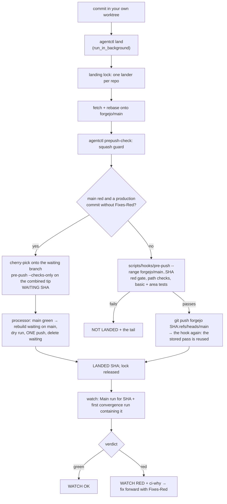

# Landing a change on main

How a commit gets from an agent's worktree onto `forgejo/main`, as the code stands on 2026-10-26 (after the owner's
"drop the landing pipeline" decision). The sources are authoritative; this page cites them and says nothing they do not:

- the pre-push hook, `scripts/hooks/pre-push` (its header lists every check), and its test list
  `scripts/hooks/local-tests.txt` (the basic and area tests);
- `~/bin/agentctl` (`land`, `ci-why`, `prepush-check`) and its reference `~/bin/AGENTCTL.md` (laptop only, not in this
  repo).

There are no PRs and no other branches on the remote: the only ref that lands is `main` (the `measure/` branches the
identity tools push are run refs, never merged).

## The policy

The owner, 2026-10-26: "drop the landing pipeline altogether, only run the basic tests before merging and merge on
green (main not green branch), if some specific area (browser / page, identity) is touched, run tests specific to that
locally (unless it takes longer than 15 mins) then / otherwise merge to main and test everything there".

- **No pre-merge CI.** Nothing waits for a branch run. `scripts/identity-landing-check` and `scripts/identity-measure`
  stay as optional tools; no LANDABLE is required anywhere. The merge queue (`agentctl queue`) is retired.
- **Before merging: the basic tests**, locally, by the pre-push hook: the path-selected lints and checks (stage 3) and
  `local-tests.txt`'s `basic` set, riding the `sbt` check.
- **An area touched: its local tests**, if they fit in 15 minutes on the laptop, warm: `identity` and `page` (measured
  times in stage 3). What does not fit (convergence, the takes measure, the integration suites) is main's.
- **Merge on green = main green**: the red gate (stage 3, step 3). Tools-only commits and `Fixes-Red:` fixes land
  while red, as before. A production change while main is red WAITS: "when waiting for main to go green, merge all
  waiting changes into one waiting branch (always use the same name) and merge it when main is green" (the owner,
  2026-10-26) — `agentctl land` puts it on the local `waiting` branch and it lands with the others in one push (stage 2b).
- **After merging, main's CI tests everything** (Main, the convergence on its lane, verify), and `agentctl land`
  watches Main and the convergence for your commit and tells you if they go red (stage 4).

## The flow



## Stage 1: commit in your own worktree

```sh
git -C ~/projects/movies fetch forgejo
git -C ~/projects/movies worktree add -b <branch> ~/projects/movies-wt-<name> forgejo/main
eval "$(~/bin/agentctl env --print)"     # sbt/java on PATH; a locked vault prints the `! secrets unlock` line
```

Never the root checkout (`scripts/hooks/pre-commit` refuses a commit there; the pre-push hook warns on every push
when the root is off `main` or dirty, via `scripts/root-checkout-check`). Install the hooks once per clone with
`scripts/install-hooks.sh`: it sets `core.hooksPath=scripts/hooks`, relative, so each worktree runs its own copy. The
hook resets an absolute `core.hooksPath` that points at this clone, and a hook run for another checkout hands over to
that checkout's copy.

Before landing: `git diff --stat forgejo/main...HEAD` lists only your files, and the test layers your change touches
are green locally (CLAUDE.md, "Run the relevant test layers").

## Stage 2: `agentctl land` — every change, identity included

```sh
~/bin/agentctl land          # from the worktree; Bash run_in_background=true, then end your turn
```

`cmd_land` / `land_loop` / `watch_landed` in `~/bin/agentctl`, in order:

1. refuses when `PREPUSH_SKIP` is set in the environment, or the tree is dirty (`--stash` sets changes aside);
2. takes the repository's **landing lock** (an flock per git common dir, `~/.cache/agentctl/land/`), waiting while
   another lander holds it (one line names the holder; 4 h bound). One lander at a time means nobody runs minutes of
   area tests on a base that is about to move, and the laptop runs one landing hook's JVM at a time;
3. `git fetch forgejo main` (one retry after 15 s);
4. `git rebase forgejo/main` (a conflict aborts the rebase and names the files);
5. `prepush-check` (the squash guard): refuses when `forgejo/main...HEAD` returns more than 2 files to an older main
   version — what `git reset --soft` onto a moved main does (`git revert` commits are exempt for their own files);
6. **main red?** When ci-why's gate is red and a pushed commit touches a production path without a `Fixes-Red:`
   naming a red run, the change goes onto the `waiting` branch instead (stage 2b) and land keeps running until it
   lands. Tools-only and Fixes-Red changes go on, as the hook lets them;
7. **check first**: `scripts/hooks/pre-push --range forgejo/main..<sha>` — the whole hook (stage 3) over exactly what
   will be pushed, pushing nothing. A failure is `NOT LANDED: the pre-push checks failed` and nothing is pushed;
8. `git push forgejo <sha>:refs/heads/main` (argv asserted free of `--no-verify` and `--force`): the hook runs again
   and reuses step 7's stored pass in seconds, so the push's ssh connection is never held open through minutes of
   tests;
9. on a push race (`non-fast-forward`, `fetch first`, …) refetch, rebase and retry from step 6, up to 3 retries;
10. fetch and verify the commit is on main (ancestor, or patch-equivalent per `git cherry`): `LANDED <sha>`. The lock
   is released;
11. **the watch** (stage 4), unless `--no-watch`.

The hook's full output is in the scratchpad's `agentctl-land-<worktree>-<pid>.log`. Exit: 0 landed and watched
green, 1 not landed, 2 landed but the watch could not tell, 3 landed and main's CI red.

## Stage 2b: the `waiting` branch, while main is red

`agentctl waiting status|cancel <id>|run` (`~/bin/AGENTCTL.md`, "waiting"):

- **One branch, always `waiting`**, local to the main clone, in the worktree `~/projects/movies-wt-waiting`; it
  exists only while changes wait.
- **Joining it** (inside `land`, under the landing lock): the change's commits are cherry-picked onto `waiting`
  (created from forgejo/main when missing) and `scripts/hooks/pre-push --checks-only forgejo/main..waiting` runs there
  — every check but the red gate, over the combined tip: the basic tests and every touched area's. A conflict or a
  failure rejects only that change, with the output; the others stay. Otherwise `WAITING <sha> (n changes queued on
  waiting)`, the lock is released, and land waits for its change's verdict.
- **Landing it**: one processor per repo (detached, locked) polls the gate. Once main is green it rebuilds `waiting` on
  the current forgejo/main change by change (one that no longer applies is rejected alone), runs the hook's `--range`
  dry run, pushes the whole branch in ONE push through the hook, and deletes the branch. Each waiting land then prints
  `LANDED <sha>` and goes on to its watch (stage 4). A failing batch is searched prefix by prefix and only the first
  failing change rejected.
- **Not for**: tools-only changes and `Fixes-Red:` fixes (they land while red), or anything while main is green.

## Stage 3: the pre-push hook

`scripts/hooks/pre-push`, run by git on every push (and by `--range` as a dry run). In order:

1. **Hand-over and hooksPath guard** (above), root-checkout warning.
2. **What is pushed.** git's stdin, one line per ref. Deleting a ref checks nothing. A push of only
   `refs/heads/measure/*` checks nothing (a measurement's run ref). For a push to `main`, `agentctl prepush-check
   --hook` (the squash guard) runs first, when `~/bin/agentctl` exists.
3. **The red gate** (push to main only; bypass name `redgate`). For each gating workflow — exactly Main (`main.yml`)
   and Identity model convergence (`identity-model-convergence.yml`), the owner's gate (2026-10-27) — it reads the newest *decided* run on main (success or failure; cancelled,
   skipped and unfinished runs say nothing), one bounded read each (`PREPUSH_GH_SECONDS`, 15 s). A Forgejo remote
   reads Forgejo's runs API with `$FORGEJO_API_TOKEN` or the `movies` vault's token if already unlocked; no token →
   the gate is skipped with one warning. An API that does not answer is warned about and skipped for that workflow,
   never a block. If any is red, every pushed commit touching a **production path** (`*/src/main/`, `conf/`,
   `*/conf/`, `build.sbt`, `project/`, `infra/nix/`, `infra/kubernetes/`, `Dockerfile`) must carry a
   `Fixes-Red: <run>` trailer naming one of the red runs — its number in the run URL or its API run id. Commits
   touching no production path (scripts, docs, skills, tests, fixtures, `.github/`) land while red. The Identity
   findings report, Record scrape fixtures (the nightly capture) and Verify scrape recording (its replay) do not gate.
4. **Changed paths**: a three-dot diff of each pushed range from its base, so commits main gained since do not count.
5. **Plan**: the checks those paths select (`scripts/hooks/pre-push --plan < paths` prints them).
6. **Reuse**: if a push with the same key passed before — pushed tree, base tree, changed paths, selected checks,
   the hook's and its helpers' bytes, the red-gate state and `PREPUSH_SKIP` — the path checks are skipped with one
   line (keys in `~/.cache/kinowo-prepush`, 14 days; single-ref pushes only; a failed run stores nothing;
   `PREPUSH_NO_REUSE=1` runs everything). The red gate always runs.
7. **Where**: in place when HEAD is the pushed commit and nothing it changed differs in the working tree; through the
   checkout's kept `scripts/sbt-warm` server if one is live; otherwise in a temporary worktree of the pushed commit
   (cold: an sbt check there takes minutes). A non-kept live sbt in the checkout also forces the temporary worktree.
8. **Area selection.** A change on the identity paths (`is_identity_path`: `identity/`,
   `worker/src/{main,test}/scala/services/identity/`, `common/src/main/resources/title-{rules,words}.tsv`,
   `common/src/main/scala/services/titlerules/`, `test/resources/fixtures/identity-*`) selects `identity`; one on the
   page paths (`is_page_path`: `web/src/main/assets/`, `web/src/main/twirl/`, `web/src/page/`,
   `page-tests-playwright/`) selects `page`. Each also selects `sbt` (so the basic tests run). The hook no longer asks
   for an identity-landing-check LANDABLE.
9. **The path checks**, in this order; a failure is recorded and the rest still run:

| Check | Runs when the push changes | What it runs | Typical time |
|---|---|---|---|
| `judgements` | `identity-judgements.tsv`, `identity-unmatched/*.tsv`, `expected-hard-clusters-*`, `scripts/ci/identity_{judgements,takes}*.py` | `scripts/ci/identity_judgements_lint.py`; for a judgements change also against the takes the newest convergence legs served | seconds (+ a cached artifact download) |
| `allowlists` | a registered allow-list (`.github/allow-lists.txt`), the registry, `scripts/ci/commit_rules*.py` | `scripts/ci/commit_rules.py allowlists`: a row only at a check's birth (`New-Check:`, TEMPORARY); the known-flips baseline only shrinks | seconds |
| `driftguards` | the identity paths, `worker/src/main/`, the drift harness (`is_drift_path`) | `scripts/ci/commit_rules.py driftguards`: a red fix touching rule code names its `Identity-Design:` doc; a harness change carries its self-test | seconds |
| `identitydrift` | to main: a drift path (`.github/identity-drift-paths.txt`) with `Fixes-Red:`, or a gate file (`.github/identity-drift-gate-paths.txt`, deletions too), or `New-Check:` | `scripts/identity-drift-ci --for-red <run>` / `--against main` on ci-runner; not from a CI job | ~12-40 min per run |
| `eslint` | `web/src/main/assets/js`, page-test JS, `eslint.config.js`, `eslint-rules/`, `package*.json`, Playwright specs | `npm run lint` (`npm ci` once per worktree) | seconds |
| `drift` | `*/src/main/scala/models/*`, `data/`, the City models, the drift script | `scripts/ci/generated-artefacts-drift.sh` | seconds |
| `snapshot` | `test/resources/fixtures/08-06-2026/`, its inputs script | `scripts/read-model-snapshot-inputs.sh check` | seconds |
| `dashboards` | `infra/nix/files/monitoring/`, `infra/test/test_dashboards.py` | `infra/test/test_dashboards.py` | < 1 s |
| `scripttests` | `scripts/`, `.github/scripts`, `.github/actions`, `android/scripts`, `ios/scripts`, `infra/bin`, `data/` | `scripts/run-script-tests --changed <base>`; beside it the same on Linux in Docker (`linux`); on a Mac again under `/bin/bash` 3.2 | seconds to minutes |
| `actionlint` | workflow files, composite actions | actionlint (+ shellcheck on `run:` blocks) | seconds |
| `shellcheck` | `*.sh`, `scripts/hooks/*` | shellcheck; fails only on warnings the push adds | seconds |
| `sbt` (+ basic) | Scala/Java, `build.sbt`, `project/`, Grafana dashboards, scripts/workflows under `scripts/`, `.github/`, `infra/`; and anything the lint specs read (`scripts/`, `.github/`, `.claude/`, `CLAUDE.md`, `build.sbt`, `project/`, `*/src/test/`, `*/src/it/`, page specs, worker fixtures, `testkit/`) | one sbt run: the Test/It/Page compiles of every touched module and its dependants (`--compile-plan`), the five standing lints, and on a repo-read change every `deploy/*Spec` and `tools/{No*,*Lint*}Spec` (`--lint-plan`) bar the server-booting ones; GitOps-reading specs only after `infra/bin/fetch-gitops` succeeds; then THE BASIC TESTS, `local-tests.txt`'s `basic` lines, in the same run | lints ~30 s + basic ~5 min warm; more cold |
| `identity` | the identity paths (step 8) | `scripts/hooks/local-tests.txt`'s `identity` lines, one `scripts/sbt-warm` call | ~5 min warm (`identity/test` 52 s; the services.identity.*/titlerules.*/scripts.* aggregate ~4 min) |
| `page` | the page paths (step 8) | `local-tests.txt`'s `page` lines: `web/PageTest/test` through `scripts/sbt-warm`, then `scripts/page-tests-local all` (fixture server + CI's Chromium and WebKit Playwright rows) | ~11 min warm (`web/PageTest/test` ~2.7 min, Chromium rows ~1.5 min, WebKit ~7 min) |
| `oldrefs` | a file in `identity-slice`'s or `title-trace`'s `TOOL_FILES` | `scripts/identity-slice-old-ref-test.sh` | incremental; minutes the first time |
| `ios` | `ios/` | `scripts/ios-compile-check.sh` | minutes |

10. **Verdict.** `all clear (<n>s)` and the pass stored for reuse, or
    `blocked by: <checks> … Fix, or bypass with PREPUSH_SKIP=…`. A hook that ran over `PREPUSH_LONG_SECONDS` (300)
    warns that the push's ssh connection, opened before the hook, may die ("closed by remote host", "Broken pipe"):
    push the same thing again and the stored pass is reused.

A local tool a check needs that is missing (sbt or a working java, shellcheck, actionlint, npm, python3 and
timezonefinder, gh, curl, jq) **blocks** the push with the fix, never a skip. Only what lies outside the machine's
install warns and passes: the gate's API unreachable, no Forgejo token, Docker or Xcode not running. GitOps manifests
that cannot be fetched block (the checkout left behind is stale).

**Checks without the gate.** `--checks-only A..B` is `--range A..B` minus the red gate (said in one line): what the
`waiting` branch is checked with while main is red; the gate is judged when it is pushed.

**The landing check on ci-runner** (`precommit-check.yml`, agentctl's remote checks) runs the hook's checks in parallel
jobs: `check (rest)`, `check (page)`, and one `heavy (<row>)` job for each of Main's heavy rows the change can move
(`PREPUSH_HEAVY_ROWS=1`): `itrest` / `itidentity` (`IT_ROW=<row> sbt itAll` against a throwaway MongoDB), `e2e`
(`sbt e2eRest`) and `e2ecorpus` (`sbt e2eCorpus`). Before 2026-10-30 Main was the first place those rows ran, and 8 of
its 14 code reds in five days were there. The laptop's own push never selects them.

**Check-only mode.** `scripts/hooks/pre-push --range A..B` runs the whole hook — gate and checks — over the commits in
`A..B`, judged as a push to main, pushing nothing. A `<remote>/main..HEAD` base reads that remote's runs, so the push
that follows reuses the pass. Use it before a manual push that may run long: `scripts/hooks/pre-push --range
forgejo/main..HEAD`. `--plan` and `--compile-plan` read paths on stdin and print the plan only.

## Stage 4: the watch after landing

With no pre-merge CI, main's CI is where a change is tested in full, so `land` keeps running after `LANDED` (the lock
already released) and watches it for the landed sha (`watch_landed`):

- **Main**: the `main.yml` run whose head is the sha; if it was cancelled or never came (a newer push superseded it),
  the newest Main run whose head contains the sha.
- **Convergence**: the FIRST `identity-model-convergence.yml` run on main created after the push whose head contains
  the sha — its own kick, a later push's, or the daily run (a cancelled one, replaced on the lane, passes to the next).
  None within 60 min (kick-convergence skips pushes outside `.github/convergence-paths.txt`):
  `convergence: none started within 60 min`, not waited for.
- **Verdict**: `WATCH OK: Main #n green, convergence #m green`; `WATCH RED: <workflow> #n <failed jobs>` plus the
  `ci-why` summary, the moment either is red; `WATCH UNKNOWN` after 3 h undecided or 10 failed reads.

Outside the watch and the gate: **Tool self-tests** (`tool-self-tests.yml`: every script self-test and
identity-slice's old-ref compile, on each push to main touching their paths). Their reds are the tooling's, listed by
`ci-why` outside the gate; they close no push. The same tests run before landing, in the hook's `scripttests` and
`oldrefs` checks, for every change touching them.

**A third party's or a backlog's problem is an alert, not a red run**: the Decodo probe, security headers (an origin
never reached), the recording's key preflight, the findings report and CI staleness run their live step through
`scripts/ci/alert-step.sh`. Their third-party exits keep the run green and file ONE owner issue
(`report-scheduled-run`'s `alert`), refreshed while it lasts and closed by the next clean run; nothing is dispatched.
Their self-tests, and any other failure, still fail red.

`WATCH RED` names a run that contains your commit, not proof that your commit broke it: read the summary. If it is
yours, fix forward at once with a `Fixes-Red: <run>` trailer (stage 5). `--no-watch` exits at `LANDED` (scripts).

## Stage 5: the gate after landing

`~/bin/agentctl ci-why [main|<run id>]` explains why main is red: the newest decided run on main of each gating
workflow, its failed jobs and lines, the commit, and a verdict (`TEST FAILURE`, `INFRA-SHAPED`, `UNCLEAR`), a newer
run in flight that may clear it, and the clearing rule. Exit 0 green, 1 red.

A red clears only when that workflow's next **decided** run on main is green (a cancelled run says nothing), or —
for the push itself — when every production commit in it carries `Fixes-Red:` naming the red run. If your commit
turned main red, fix it at once with a `Fixes-Red: <run>` trailer in the final trailer block, beside
`Co-Authored-By`.

**A new check gates only once it has been green** (`.github/gating-checks.tsv`, `scripts/ci/gating_checks.py`): a new
job in Main or the convergence workflow, a new runner label, or a new gate workflow lands with its registry row as
`unproven` (the hook's `newchecks` check and Main's `commit rules` job hold every job to a row). A run red only in
unproven jobs (and the aggregates that follow them: `ci`, `timings`, a leg's wrapper) is no red for the push gate: it
reports. Its first green run proves it: `scripts/ci/gating_checks.py prove --workflow-file main.yml --run <run id>
--number <#n>`, committed.

## When something blocks you

| Message | Meaning | What to do |
|---|---|---|
| `NOT LANDED: PREPUSH_SKIP is set …` | land never skips checks | `unset PREPUSH_SKIP` |
| `NOT LANDED: the working tree has uncommitted changes` | dirty tree | commit, or `land --stash` |
| `NOT LANDED: rebase onto forgejo/main conflicts in: …` | your change conflicts with main | resolve by hand (`git rebase forgejo/main`), land again |
| `NOT LANDED: prepush-check refused: … would be reverted/deleted back to an older main version` | a squash onto a moved main | rebuild your commits on current main by rebase, never `reset --soft` |
| `<workflow> is RED on main: run …` / `NOT LANDED: the red gate refused the push` | a gating run is red and a production commit lacks `Fixes-Red:` | `agentctl ci-why`; wait (`agentctl wait run <id>` in the background) for the green run, or add `Fixes-Red:` only if your commit fixes that run |
| `red-build gate UNREAD (…): the push is REFUSED` | the gate could not be read (no Forgejo token, API error, no answer after 3 tries); it fails closed, so a production push is refused (a tools-only push still lands) | no token: `secrets unlock movies` (the user's Touch ID), then land again (agentctl hands the token to its processes); otherwise `agentctl env --check` for the tunnel, and land again |
| `<tool> not found: the <check> check cannot run, so the push is BLOCKED` | a local tool is missing | install it as the message says; `eval "$(~/bin/agentctl env --print)"` for sbt/java |
| `GitOps manifests STALE … BLOCKED` | `infra/bin/fetch-gitops` could not reach movies-gitops | `launchctl kickstart -k gui/$(id -u)/net.bitcashier.forgejo-tunnel`, land again |
| `blocked by: <checks>` | a path check failed | read the tail (and the land log), fix forward, commit, land again |
| push dies after `all clear` ("closed by remote host", "Broken pipe") | the tunnel dropped under a long hook | push/land again: the pass is reused |
| `NOT LANDED: still racing after 3 retries` | main is busy | land again in a minute |
| `waiting for the landing lock (…), held by: …` | another agent is landing | nothing: land continues once it is free |
| `NOT LANDED: timed out waiting for the landing lock` | a lander held it 4 h | `agentctl land` again; if it repeats, report the holder |
| `NOT LANDED: the pre-push checks failed` | the dry run (basic or area tests, a path check) failed | read the tail and the land log, fix forward, commit, land again |
| `blocked by: identity` / `blocked by: page` | the area's local tests failed | as above; the area log's path is in the tail |
| `WATCH RED: <workflow> #n …` (exit 3) | main's CI is red on a run containing your commit | read the ci-why summary; yours → fix forward now with `Fixes-Red: <n>`; not yours → say so in your report |
| `WATCH UNKNOWN …` (exit 2) | undecided after 3 h, or Forgejo unreadable | `agentctl ci-why` later; report it |
| `WAITING <sha> (n changes queued on waiting)` | main is red; your production change waits on `waiting` | nothing: land keeps running and ends LANDED + the watch once main is green |
| `NOT LANDED: main is red, and the change conflicts with the changes already waiting` | your change and a waiting one touch the same lines | rebase onto `waiting` (`git rebase waiting`) and land again, or wait for them to land |
| `NOT LANDED: the checks failed on waiting` | the combined tip fails a check | yours: fix forward, land again |
| `NOT LANDED: main moved while it waited and the change no longer applies` | main conflicts with your waiting change | rebase onto forgejo/main, land again |
| `agentctl queue …` prints `NOT QUEUED: the merge queue is RETIRED` | an old brief | use `agentctl land` |

## The rules

- **No bypass flags.** `PREPUSH_SKIP="<checks>"` (names: every check above, plus `redgate`, `lintspecs`, `linux`)
  and `git push --no-verify` exist in the hook for a person; agents never use them, on any commit or push, `measure/`
  branches included. `agentctl land` refuses to run with `PREPUSH_SKIP` set and asserts no `--no-verify` in its push
  argv. A missing tool is fixed, not skipped.
- **`Fixes-Red:` only for a real fix** of the named run. A tools-only commit needs none.
- **Never rerun to green.** A red is investigated to its cause (CLAUDE.md, "Investigate every red"); a test that
  passes on a second run is flaky and gets fixed.
- **Rebase onto current `forgejo/main` before any local check** (`land` does); never `reset --soft` onto a moved main.
- **Area tests are local and bounded.** A set in `local-tests.txt` joins an area only if it runs in under 15 min on the
  laptop, warm; anything longer is main's CI's. Add a new area by adding its lines and its path test to the hook.
- **Never edit `identity-drift-allow.tsv` to get green**; performance budgets move only for a deliberate trade.
- **A drift or flip red** is fixed in the incremental state that diverges, never with a new resolver rule (a
  `Fixes-Red:` commit touching rule code needs `Identity-Design: <doc>`), and is not closed until its listing's drift
  slice is committed (`scripts/identity-slice <cc> --venue V --title T --emit-drift-slice`) or the fix says
  `Drift-Slice: none -- <why>`; a change to the drift harness carries its
  capture-replay self-test (or `Drift-Harness-Refactor: <why>`). Pre-push's `driftguards` check
  (`scripts/ci/commit_rules.py`) holds both; `docs/design/identity-no-drift.md`, "Fixing a drift or flip red".
- Cancel your own superseded CI runs (`forgejo-gh run cancel <run id>`); never another agent's.
