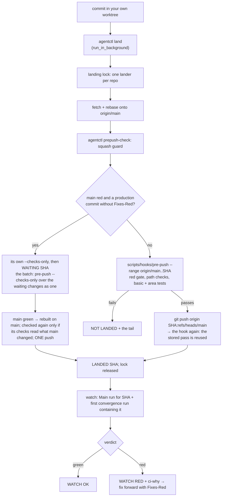

# Landing a change on main

How a commit gets from an agent's worktree onto `origin/main`, as the code stands on 2026-10-26 (after the owner's
"drop the landing pipeline" decision). The sources are authoritative; this page cites them and says nothing they do not:

- the pre-push hook, `scripts/hooks/pre-push` (its header lists every check), and its test list
  `scripts/hooks/local-tests.txt` (the basic and area tests);
- `~/bin/agentctl` (`land`, `ci-why`, `prepush-check`) and its reference `~/bin/AGENTCTL.md` (laptop only, not in this
  repo).

There are no PRs and no other branches on the remote: the only ref that lands is `main` (the `measure/` branches the
identity tools push are run refs, never merged).

## Landing a refactor: the checklist

One page for a refactoring lane (complexity, coupling, moves, splits), identity code included; the sections below and
CLAUDE.md say why. Where a lane's time went on 2026-11-19 (72 agents, `scripts/agent-time --since 2026-11-19T00:00+00:00`):
waiting on `agentctl land` 39%, the model's own work 22%, idle gaps 10%, local sbt 5%, what-if and measurements 3%.
Landing is the cost, so land fewer, bigger, cleaner changes and keep working while one is queued.

1. **Worktree:** `git worktree add -b <lane>/<step> ../movies-<lane>-<step> origin/main`; `eval "$(~/bin/agentctl env --print)"`.
2. **Before the first edit, pin what you will rewrite** (a report each, never a gate; the `test-layers` skill,
   "Refactoring safety tools"): `scripts/coverage-touched <base>..<head>` lists the touched methods the reaching specs
   leave unrun, and `scripts/mutation-check <base>..<head>` the behaviour changes they would miss (surviving mutants) --
   run both on the range you are about to change (a draft of the refactor, or the commits that last touched the
   code), and write the missing pinning tests first. Move a class with `scripts/scalafix-move <from> <to>`, fix import
   order with `scripts/scalafix-organize`, never by hand; `scripts/dead-code` lists what nothing calls any more.
   Changed the resolver's hot paths or the take-up? `scripts/identity-boot-cost` (bytes a family, held to its
   baseline).
3. **Edit, then commit each stable step** with the test that proves it (the commit gate). A refactor's proof is the
   existing tests staying green plus, for a fall, `scripts/ratchet-diff --measure origin/main` (paste its table; never
   write numbers by hand). Record a fall with `scripts/coupling-report --update` / `scripts/quality-report --update`;
   a rise needs its `Coupling:` / `Complexity:` / `Length:` / `Duplication:` trailer; splitting a frozen class, ask
   `scripts/coupling-report --check-split <X> <piece>...` before landing (it prints the `Coupling: split of` trailer).
4. **A pure move?** Run `scripts/pure-move-check origin/main..HEAD`. `PURE MOVE` -> put `Pure-Move: verified` in the
   message's LAST paragraph, directly above `Co-Authored-By:` with no blank line between (a line above a blank line is
   prose to git; 2 of 2026-11-19's 3 claims were lost that way). `NOT PURE` names the edits: move them to a commit of
   their own, then check the move again. Such a commit owes
   no what-if, its identity paths select no identity area in the landing check (the hook's `puremove` check re-proves
   it instead) and it may join a backlog batch like any non-identity change. Keep moves and edits in separate commits:
   only the edits then pay for identity.
5. **Identity code changed beyond a move:** `scripts/identity-what-if` (it skips a pure move by itself; its base side
   is kept per mirror moment, so a second run is the head side only). 0 takes moved in every country -> land. Any take
   moved -> it is a behaviour change, not a refactor: stop and judge it (`identity-investigation` skill).
   **The stamps are kept by themselves** either way (step 4 or 5): `agentctl land` runs `scripts/land-before-queue`
   after its rebase, whose `scripts/identity-stamp-carry auto` commits the carry rows into the same push (each pure
   move, or the change by its whole five-country what-if). The deploy then re-resolves no stored family on boot; the
   hook's `stampcarry` check proves each row again.
6. **Local layers, narrowed:** `scripts/sbt-warm "<module>/testOnly <the specs you touched or that read it>"`, the
   module's `testUnit` only when you changed shared code, `scripts/run-script-tests --changed origin/main` for any
   script. The landing check runs the rest on CI (ci-runner; the identity shards on GitHub's hosted runners) -- don't
   run it twice on the laptop.
7. **Rebase onto origin/main, then land:** `~/bin/agentctl land --until-done > <scratchpad>/land-<lane>-<n>.log 2>&1`
   (Bash `run_in_background=true`). Conflicts in the generated baselines resolve themselves (the queue merges or
   regenerates them).
8. **While it is queued, keep working:** start the next step in a NEW worktree branched from your queued branch
   (`git worktree add -b <lane>/<next> ../movies-<lane>-<next> <lane>/<step>`) and land it only after the first one
   says `DONE`/`LANDED` (its landed commits then drop out of the rebase). Don't sit on the land log.
9. **Verdict:** `DONE` -> report the sha and the ratchet table. `NOT LANDED` -> do the `next:` line it prints; a
   checks failure is yours (reproduce it with the named test locally), never a re-land to see if it passes.

## The policy

The owner, 2026-10-26: "drop the landing pipeline altogether, only run the basic tests before merging and merge on
green (main not green branch), if some specific area (browser / page, identity) is touched, run tests specific to that
locally (unless it takes longer than 15 mins) then / otherwise merge to main and test everything there".

- **No pre-merge CI.** Nothing waits for a branch run. `scripts/identity-landing-check` and `scripts/identity-measure`
  stay as optional tools; no LANDABLE is required anywhere. The merge queue (`agentctl queue`) is retired.
  `identity-measure --timeout` (default max(120 min, 1.5 x the ETA it prints)) only stops the waiting: the CI run and its
  branch stay, exit 3 = still running, collect with `--run <id>`; `--cancel-on-timeout` cancels instead.
- **Before merging: the basic tests**, locally, by the pre-push hook: the path-selected lints and checks (stage 3) and
  `local-tests.txt`'s `basic` set, riding the `sbt` check.
- **An area touched: its local tests**, if they fit in 15 minutes on the laptop, warm: `identity` (measured times in
  stage 3). What does not fit (convergence, the takes measure, the integration suites) is main's.
- **The page tests and `e2e (rest)` run after landing, on Main** (the owner, 2026-11-17, "B1": a week of landing checks
  saw 0 failures in 14 page-area runs, 317 runner-minutes, and 0 in 95 `e2e` runs, 303). The `page` area left the hook
  and `local-tests.txt`, `check (page)` and the `e2e` heavy row left the landing check. Main's `page-tests-*` and
  `e2e (*)` rows are gate rows (`.github/gating-checks.tsv`): a failure is a normal gate red with a fixer. Running the
  page layer locally for a UI change (`scripts/page-tests-local`) is recommended insurance, not a landing requirement.
- **After landing too, on Main (the owner, 2026-11-21):** identity-slice's old-ref compile (main.yml's
  `old-ref-compile`, a gate row: 1 catch in 27 landing checks, at a p90 of 20 min; no hook check, landing-check job
  or land-precheck rule any more; it diffs from where it last passed on main, `refs/verified/old-ref-compile`
  via `scripts/ci/verified-ref.sh`, so a replaced run's tool change is still compiled) and the identity area's slowest specs (FamilyIndexCompleteness, the four
  IdentityDriftSlices, FamilyConvergenceSlices, the four ReadSetClosure parts: 0 catches no other spec made in 356
  landing checks over 14 days, ~1,750 of the shards' ~3,750 suite-seconds; Main's worker rows run them). A failure
  there is a normal gate red with a fixer.
- **Merge on green = main green**: the red gate (stage 3, step 3). Tools-only commits and `Fixes-Red:` fixes land
  while red, as before. A production change while main is red WAITS: "when waiting for main to go green, merge all
  waiting changes into one waiting branch (always use the same name) and merge it when main is green" (the owner,
  2026-10-26) — it joins the waiting batch, which pre-checks every waiting change as one while red and lands them in one
  push at green (stage 2b).
- **After merging, main's CI tests everything** (Main, the convergence on its lane, verify), and `agentctl land`
  watches Main and the convergence for your commit and tells you if they go red (stage 4).

## The flow



## Stage 1: commit in your own worktree

```sh
git -C ~/projects/movies fetch origin
git -C ~/projects/movies worktree add -b <branch> ~/projects/movies-wt-<name> origin/main
eval "$(~/bin/agentctl env --print)"     # sbt/java on PATH; a locked vault prints the `! secrets unlock` line
```

Never the root checkout (`scripts/hooks/pre-commit` refuses a commit there; the pre-push hook warns on every push
when the root is off `main` or dirty, via `scripts/root-checkout-check`). Install the hooks once per clone with
`scripts/install-hooks.sh`: it sets `core.hooksPath=scripts/hooks`, relative, so each worktree runs its own copy. The
hook resets an absolute `core.hooksPath` that points at this clone, and a hook run for another checkout hands over to
that checkout's copy. `scripts/hooks/post-commit` runs the commit rules the precheck refuses on (`allowlists`,
`driftguards`: Fixes-Red / Gauges / Drift-Slice trailers) over each commit as it is made, in ~0.1 s, and says what to
amend; it never blocks the commit (`KINOWO_POST_COMMIT_RULES=0` turns it off).

Before landing: `git diff --stat origin/main...HEAD` lists only your files, and the test layers your change touches
are green locally (CLAUDE.md, "Run the relevant test layers").

## Stage 2: `agentctl land` — every change, identity included

```sh
~/bin/agentctl land --until-done   # an agent's LAST step, from its worktree; Bash run_in_background=true, end your turn
```

**`--until-done` owns the tail** (the owner, 2026-11-18; `~/bin/AGENTCTL.md`, "land --until-done"): it rebases and
queues the change -- or, called again after an interruption, resumes its own entry (by worktree and head; never
queued twice) -- runs the fast precheck in the foreground and waits for the verdict, bounded by `--deadline` (4 h).
Its last line is what you act on, once:

| last line | exit | do |
|---|---|---|
| `DONE <sha> ...: worktree removed` | 0 | every local commit's patch is on origin/main; the worktree and its branch are gone (no `git branch -D` by hand). Report once, naming the sha. |
| `NOT LANDED: <why>` then `next: <command>` | 1 | run the named next step (rebase onto origin/main, or fix and commit), then `land --until-done` again |
| `NOT DONE: <id> is <state> ...` | 2 | the deadline: run it again; it resumes the same entry |
| `LANDED <sha> ...; NOT DONE: the worktree ... is kept: <why>` | 3 | landed; the worktree was not provably clean, yours and merged -- say why in the report, never force-remove it |

A plain `agentctl land` still prints `QUEUED <id>` and leaves the rest to the inbox. In the queue, a change sharing a
FILE with an older change still in flight is checked as one with it -- in one backlog batch, or after it lands, on top
of it -- and when the two cannot be assembled together its author gets `CONFLICTS <id>: ...` in the inbox at once,
not a NOT LANDED after a whole check (`~/bin/AGENTCTL.md`, "OVERLAPPING CHANGES ARE CHECKED AS ONE").

`cmd_land` / `land_loop` / `watch_landed` in `~/bin/agentctl`, in order:

1. refuses when `PREPUSH_SKIP` is set in the environment, or the tree is dirty (`--stash` sets changes aside);
2. takes the repository's **landing lock** (an flock per git common dir, `~/.cache/agentctl/land/`), waiting while
   another lander holds it (one line names the holder; 4 h bound). One lander at a time means nobody runs minutes of
   area tests on a base that is about to move, and the laptop runs one landing hook's JVM at a time;
3. `git fetch origin main` (one retry after 15 s);
4. `git rebase origin/main` (a conflict aborts the rebase and names the files);
5. `prepush-check` (the squash guard): refuses when `origin/main...HEAD` returns more than 2 files to an older main
   version — what `git reset --soft` onto a moved main does (`git revert` commits are exempt for their own files);
6. **main red?** When ci-why's gate is red and a pushed commit touches a production path without a `Fixes-Red:`
   naming a red run, the change joins the waiting batch instead (stage 2b) and land keeps running until it lands. Tools-only and Fixes-Red changes go on, as the hook lets them;
7. **check first**: `scripts/hooks/pre-push --range origin/main..<sha>` — the whole hook (stage 3) over exactly what
   will be pushed, pushing nothing. A failure is `NOT LANDED: the pre-push checks failed` and nothing is pushed;
8. `git push origin <sha>:refs/heads/main` (argv asserted free of `--no-verify` and `--force`): the hook runs again
   and reuses step 7's stored pass in seconds, so the push's ssh connection is never held open through minutes of
   tests;
9. on a push race (`non-fast-forward`, `fetch first`, …) refetch, rebase and retry from step 6, up to 3 retries;
10. fetch and verify the commit is on main (ancestor, or patch-equivalent per `git cherry`): `LANDED <sha>`. The lock
   is released;
11. **the watch** (stage 4), unless `--no-watch`.

The hook's full output is in the scratchpad's `agentctl-land-<worktree>-<pid>.log`. Exit: 0 landed and watched
green, 1 not landed, 2 landed but the watch could not tell, 3 landed and main's CI red.

## Stage 2a: the fast precheck, beside the queue

`agentctl land` starts `scripts/land-precheck` DETACHED right after `QUEUED` (review 2026-11-06, P1; the owner: landing
must not take longer, so it never runs before the queue). It answers "will the landing check reject this for a reason
visible now?" in ~20-60 s on a warm checkout:

- **rebase**: the change replayed onto origin/main by `git replay`, touching no ref or file; a conflict names its files;
- **rules**: the hook's own `allowlists driftguards newchecks judgements shellcheck actionlint` checks
  (`PREPUSH_ONLY`, `--checks-only`, so not the red gate), the stranded-trailer rule with them;
- **lints**: the specs the LINT REGISTRY (`scripts/hooks/lint-registry.tsv`) selects for the pushed paths, in one
  `scripts/sbt-warm` call, its JVM admitted by the governor as a landing check's (`KINOWO_GOV_CLASS=check`).

Not the script self-tests (2026-11-17): the landing check runs them on every change, so the precheck's run was the same
tests twice (148 s beside the check's 125 s).

A rebase or rules refusal ends the precheck at once: the lints and self-tests are skipped (`refused already`), so that
refusal comes back in seconds rather than after the lints' wait on sbt and a JVM slot.

A refusal cancels the queued change and puts `NOT LANDED: the fast precheck refused <id> (<sha>): PRECHECK FAIL:
<steps>` in the inbox, its lines in the tail: fix, commit, land again. A precheck that could not run (exit 2: sbt never
came up, a bound ran out) leaves the change to the landing check. Run it yourself before landing with
`scripts/land-precheck`; `agentctl land --no-fast-precheck` starts none (name it in your report).

**The lint registry.** The hook's `sbt` check selects its lint specs from that table, each row naming what the spec
reads -- WHAT THE SPEC OPENS, nothing wider (the owner, 2026-11-21: agentctl keeps a change's verdict when main moved
outside what its checks read, and 175 `@repo` rows, selected by any script, workflow, skill or test-tree path, made
every two changes share a lint): a pattern such as `.github/workflows/*` or `*/src/main/scala/*`, `*` always, `@code`
its own code alone (every row is also selected by the test-side code its spec compiles with), `@gitops` with the
manifests fetched, `-` never; `@per-file` beside them marks a spec judging each file alone, which agentctl counts as
shared by two changes only through a file both change or its own code (`pre-push --per-file-lints`; proved by
`scripts/ci/lint_per_file_check.py`) -- not from a spec's name: LoadIndependentTestsSpec and InMemoryStoresRoundTripSpec
matched no name pattern and turned Main red 7 times. A new repo-reading spec needs its row:
`scripts/hooks/lint-registry-test.sh` fails without it. So does EVERY SPEC READING A CHECKED-IN OR GENERATED ARTEFACT
(the owner, 2026-11-18, after Main #2547/#2550 and #2601 passed every local check): a literal naming a repo path or a root
file (`"Dockerfile"`), a classpath resource it opens (`getResourceAsStream("/routes")`), or any resource opener or
`RepoFile` call -- `scripts/ci/lint_registry_reads.py --missing` names such a spec without a row, `--suggest` prints
the row it wants, `--reads <spec>` what it reads. What a spec opens by a name no literal gives,
`scripts/ci/lint_reads_trace.py <spec>` sees by running it (each file's access time): it names every file the spec
opened that its row does not select, and `--suggest` the row its reads want -- run it for a new or widened row. A file a row names runs the `sbt` check by itself (a
Dockerfile-only or AOT-list-only push ran none; a pattern selects its spec only when the check runs anyway), and a scraper change selects `AotClassListSpec` (a new class there,
a new source or an anonymous one, must be in the worker's AOT list): a missing entry fails locally in seconds.

## Stage 2b: the waiting batch, while main is red

Every change lands through a batch (the owner, 2026-11-20: "batching waiting changes ... structurally, not just now";
`~/bin/AGENTCTL.md`, "THE BATCH IS THE MECHANISM"). While the gate is red:

- **Joining it**: a production change that must wait (no `Fixes-Red:` naming the red) is still checked on its own
  (`--checks-only`, in parallel in the free check trees) and joins the waiting batch: `WAITING <sha> (entry <id>, n
  waiting)`.
- **The pre-check**: the waiting batch pre-checks the waiting changes, at most 8 a round in queue order, as ONE tree on
  the current main: `pre-push --checks-only` over the combined tip, every check but the red gate, the union of their
  areas. It runs again whenever a change joins or leaves; main moving while red is judged once, at green. A change that
  no longer applies is rejected alone, its conflict files named; a generated or hand-written table (the baselines,
  coupling-exemptions.tsv, ...) is merged row by row, never a conflict. A failure is searched prefix by prefix, and the
  culprit is rejected only when the failure is its own: a test failing only where main fails too (the red itself)
  rejects nobody. Tools-only changes and red fixes go on landing meanwhile: the pre-check holds no push.
- **Landing it at green**: the batch is rebuilt on the new main and pushed in ONE push. How much is checked again
  depends on the members:
  - **No check again**: when its members are exactly the pre-checked ones and none of their checks reads what main
    changed since (the red's fix, usually; agentctl's MINIMAL RECHECKS reads the hook's own plans). The verdict is
    `pre-checked as one on <sha>; ... its verdict kept`.
  - **The `--fast-only` check of the combined tip**: when a check of theirs does read what main changed.

  Each change then prints `LANDED <sha>` and goes on to its watch (stage 4).
- **Not for**: tools-only changes, which land while red, and `Fixes-Red:` fixes. A red fix keeps its own lane, checked
  and pushed alone first: in 2026-11-17..20 a red fix landed in a median 14 min, a batch member in 56.

## Stage 2c: the backlog batch, while changes queue at green

The owner (2026-11-17): "batch whenever there's a backlog, not only on red". With 6-8 changes queued, each paid a
30-40 min check of its own, most of it waiting for a ci-runner check slot. So at green, with no batch open, 2 or more
queued changes that no checker has taken yet are checked TOGETHER (`~/bin/AGENTCTL.md`, "THE BACKLOG BATCH"):

- **Who joins**: up to 8, in queue order. Identity changes join too (2026-11-20): the batch's check runs the union of its
  members' areas, and G5's drift check of a tip holding more than one identity-model commit tells which one moved takes.
  Never a change landed with `agentctl land --no-batch`, a red fix, or a combined-tree verification round: those are
  checked alone, beside the batch. A change that does not apply on top of the others is left out and checked alone.
- **The check**: the batch's tip gets the FULL landing check a change gets (`--range`; on ci-runner a precommit-check
  round on `check/batch-<tip>`, area tests and heavy rows included), not `--fast-only`: no member was checked alone. It
  takes ONE check tree.
- **Pass**: one push (the check's run vouches for it, `PREPUSH_REMOTE_RUN`); each change is `LANDED`, with its own
  watch (stage 4) and its own landing record (`batch_id`, `batch` size).
- **Fail**: searched prefix by prefix; the culprit is rejected only after its prefix fails again AND the failure is its
  own (a test that fails on main too, a time cap or an infra failure sends it to a check of its own instead); the
  changes before it land at once; the rest queue again for the next batch.
- While it checks, no other change pushes (a push would move main under it), except a red fix, which keeps its own
  check tree and lands alone. A change queued meanwhile joins the next batch.

## Stage 2d: the push batch, when checked changes each owe a verify round

The owner (2026-11-17): "combine them instead of landing them one by one". A change fully checked on a main that has
moved since owes a verify round (`--verify-only`, stage 3) before it pushes, and the oldest verification pushes first;
so N checked changes used to land one after another, each paying a check-runner wait plus a ~10 min verify round after
the previous push moved main. Now, at green with no batch open and no change's own verify round running, 2 or more such
changes are verified and pushed TOGETHER (`~/bin/AGENTCTL.md`, "THE PUSH BATCH"):

- **Who joins**: up to 4, oldest first: changes checked on an older main, or queued for their verify round. Never a red
  fix (it pushes alone, first, even while a push batch verifies), a `land --no-batch` change or one held by a known
  red. A member that needs a FULL round on the current main (agentctl's file-overlap and build-aware rules, judged
  against main plus the members before it) is left out and checked again alone, as before.
- **The check**: ONE `--verify-only <the oldest member's full base>..<tip>` round over the union (on ci-runner
  `check/verify-<base>-batch-<tip>`): every test config compiled, the lints, the fast specs and the unit tests of every
  module any member, or what landed meanwhile, touches. More than one identity-model commit in it also runs G5's drift
  check of its tip.
- **Pass**: one push (the plan the members' full checks passed is skipped; the hook judges the red gate); each change
  `LANDED` with its own watch and landing record (`batch_id`, `batch` size).
- **Fail**: searched prefix by prefix as the backlog batch is; the confirmed culprit rejected, the changes before it
  land, the rest verify again in the next push batch.
- A change checked while a push batch verifies waits for it and joins the next one.

## Stage 3: the pre-push hook

`scripts/hooks/pre-push`, run by git on every push (and by `--range` as a dry run). In order:

1. **Hand-over and hooksPath guard** (above), root-checkout warning.
2. **What is pushed.** git's stdin, one line per ref. Deleting a ref checks nothing. A push of only
   `refs/heads/measure/*` checks nothing (a measurement's run ref). For a push to `main`, `agentctl prepush-check
   --hook` (the squash guard) runs first, when `~/bin/agentctl` exists.
3. **The red gate** (push to main only; bypass name `redgate`). For each gating workflow — exactly Main (`main.yml`),
   Identity model convergence (`identity-model-convergence.yml`), the owner's gate (2026-10-27), and Identity takes
   (`identity-takes.yml`: the takes rows, split off on 2026-11-08, dispatched by every convergence run's preflight;
   unproven in the registry, so reporting, until its first green run on main) — it reads the newest *decided* run on main (success or failure; cancelled,
   skipped and unfinished runs say nothing; nor does an INCOMPLETE run, red only in aggregates of
   `.github/gating-checks.tsv` such as Identity takes' `verdict complete` -- the drift explorer's replay is none: it calls
   Identity takes inside its own run, under its own name, since 2026-11-15 -- which agentctl reads as NO VERDICT: the complete run before it decides, the owner 2026-11-08), one bounded read each (`PREPUSH_GH_SECONDS`, 15 s). A gate gh
   cannot read refuses a production push (it fails closed; a tools-only push still lands). If any is red, every pushed commit touching a **production path** (`*/src/main/`, `conf/`,
   `*/conf/`, `build.sbt`, `project/`, `infra/nix/`, `infra/kubernetes/`, `Dockerfile`) must carry a
   `Fixes-Red: <run>` trailer naming any red run of the current episode — its number in the run URL or its API run
   id (see stage 5, "A fix matches the red it fixes"). Commits
   touching no production path (scripts, docs, skills, tests, fixtures, `.github/`) land while red. The Identity
   findings report, Record scrape fixtures (the nightly capture) and Verify scrape recording (its replay) do not gate.
4. **Changed paths**: a three-dot diff of each pushed range from its base, so commits main gained since do not count.
5. **Plan**: the checks those paths select (`scripts/hooks/pre-push --plan < paths` prints them).
6. **Reuse**: if a push with the same key passed before — pushed tree, base tree, changed paths, selected checks,
   the hook's and its helpers' bytes, the red-gate state and `PREPUSH_SKIP` — the path checks are skipped with one
   line (keys in `~/.cache/kinowo-prepush`, 14 days; single-ref pushes only; a failed run stores nothing;
   `PREPUSH_NO_REUSE=1` runs everything). The red gate always runs.
7. **Where**: in place when HEAD is the pushed commit and nothing it changed differs in the working tree; through the
   checkout's kept `scripts/sbt-warm` server if one is live; otherwise in a temporary worktree of the pushed commit
   (cold: an sbt check there takes minutes). A non-kept live sbt in the checkout also forces the temporary worktree.
8. **Area selection.** A change on the identity paths (`is_identity_path`: `identity/`,
   `worker/src/main/scala/services/identityadapters/`, `common/src/main/resources/title-{rules,words}.tsv`,
   `common/src/main/scala/services/titles/rules/`, `common/src/main/scala/services/titles/TitleNormalizer.scala`,
   `test/resources/fixtures/identity-*`; and what the identity specs read beside them, 2026-11-19: their own spec trees
   `*/src/test/scala/services/{identity,titles/rules}/`, `worker/src/test/scala/scripts/`, the hard-cluster ratchet
   and `tools.CountryScope`, the worker's fixtures config `worker/src/fixtures/` (the capture readers), testkit's
   `services/identity/` doubles and its two normalizers, `test/resources/fixtures/{corpus,drift-slices}/`) -- or on
   what the identity specs read by class alone (`is_identity_reach_path`, 2026-11-19: common's production code
   `common/src/main/{scala,java}/`, models and tools, and the testkit's generic helpers `testkit/src/main/scala/`,
   MutableClock, SpecClock) -- selects `identity`, and `sbt` with it (so the basic tests run). The test-impact selection then narrows the area to the
   specs the change reaches; one reaching none runs nothing, not even the slice coverage. The page
   paths (`web/src/main/assets/`, `web/src/main/twirl/`, `web/src/page/`) select `sbt` only: no `page` area since
   2026-11-17. The hook no longer asks for an identity-landing-check LANDABLE.
9. **The path checks**, in this order; a failure is recorded and the rest still run:

| Check | Runs when the push changes | What it runs | Typical time |
|---|---|---|---|
| `judgements` | `identity-judgements.tsv`, `identity-unmatched/*.tsv`, `expected-hard-clusters-*`, `scripts/ci/identity_{judgements,takes}*.py` | `scripts/ci/identity_judgements_lint.py`; for a judgements change also against the takes the newest convergence legs served | seconds (+ a cached artifact download) |
| `allowlists` | a registered allow-list (`.github/allow-lists.txt`), the registry, `scripts/ci/commit_rules*.py` | `scripts/ci/commit_rules.py allowlists`: a row only at a check's birth (`New-Check:`, TEMPORARY); the known-flips baseline only shrinks | seconds |
| `driftguards` | the identity paths, `worker/src/main/`, the drift harness (`is_drift_path`), or any pushed commit carrying `Fixes-Red:` (CI judges every one) | `scripts/ci/commit_rules.py driftguards`: a red fix touching rule code names its `Identity-Design:` doc; a harness change carries its self-test; a gate/hold/settle/ask change ships its gauges first (`Gauges-Shipped: <sha>`) | seconds |
| `stampcarry` | a change to `test/resources/identity-stamp-carry.tsv` | `scripts/identity-stamp-carry verify <range>`: every carry row added or changed, proven again for exactly its base and head (pure-move-check re-run, or the recorded whole 5-country what-if re-read; both raw digests rebuilt). A row it cannot prove refuses the push | seconds when the trees are compiled |
| `puremove` | any pushed commit carrying `Pure-Move:`, whatever it touches | `scripts/pure-move-check <sha>^..<sha>` over each such commit: the trailer reads `Pure-Move: verified` and the commit only moves code (files, packages, classes renamed; path lists and baselines following them). Optional: required of no commit, verified when present | seconds a commit |
| `flipbacklog` | `identity-flip-backlog.tsv`, `identity-flips-struck.tsv`, `drift-gate-seeds.tsv`, `drift-slices/`, `identity-slices/`, `scripts/ci/population_walk_diff*.py` | every slice the change brings (its files or its `population` rows differ from the merge base's) walked with `PopulationMonotonicitySpec.main` and judged on the known rows alone, as main's spec judges it: a flip no row names refuses with the row to add (Main #2515). `scripts/identity-slice --emit-drift-slice` files those rows itself | none without a slice brought; ~10 s warm for one |
| `identitydrift` | to main: a drift path (`.github/identity-drift-paths.txt`) with `Fixes-Red:`, or a gate file (`.github/identity-drift-gate-paths.txt`, deletions too), or `New-Check:` | `scripts/identity-drift-ci --for-red <run>` / `--against main` on ci-runner; not from a CI job | ~12-40 min per run |
| `eslint` | `web/src/main/assets/js`, page-test JS, `eslint.config.js`, `eslint-rules/`, `package*.json`, Playwright specs | `npm run lint` (`npm ci` once per worktree) | seconds |
| `drift` | `*/src/main/scala/models/*`, `data/`, the City models, the drift script | `scripts/ci/generated-artefacts-drift.sh` | seconds |
| `snapshot` | `test/resources/fixtures/08-06-2026/`, its inputs script | `scripts/read-model-snapshot-inputs.sh check` | seconds |
| `dashboards` | `infra/nix/files/monitoring/`, `infra/test/test_dashboards.py` | `infra/test/test_dashboards.py` | < 1 s |
| `metricalerts` | the rule files, the Grafana alerts, `infra/test/app-metrics-catalogue/`, `*/src/main/*etrics*`, the fleet exporters (an `infra/nix` `*.sh`/`*.nix` or `scripts/ci/*.py` echoing `# TYPE kinowo_`), `test/resources/metrics-without-alerts.tsv` | `infra/test/test_metric_alert_coverage.py`: every `kinowo_*` family and recording rule read by an alert, or a row (metric, reason, owner) in the TSV; PyYAML from `scripts/python-venv`'s pinned venv | ~1 s |
| `scripttests` | `scripts/`, `.github/scripts`, `.github/actions`, `android/scripts`, `ios/scripts`, `infra/bin`, `data/`, or a path matching a glob a self-test declares it reads (`# script-test-reads:`; `scripts/run-script-tests --reads`: every workflow, `.py` and Scala spec) | `scripts/run-script-tests --changed <base>`; beside it the same on Linux in Docker (`linux`; not when the hook already runs on Linux, as ci-runner's landing checks do); and the floor bash 3.2 in its own scope (`--bash`: every bash file the push touches parsed by it, its added lines held to the constructs 3.2 lacks, their own self-tests re-run under it; `scripts/floor-bash`: a Mac's `/bin/bash`, on Linux -- ci-runner -- the GNU 3.2.57 `--install` builds; none BLOCKS, `PREPUSH_SKIP=floor`). A test leaving anything in the checkout fails as POLLUTE, named (run-script-tests' THE TREE IS LEFT AS FOUND). Opt-in, `PREPUSH_STRESS=N`: the concurrency-heavy tests selected (`# script-test-stress:`) run N times at once beside CPU burners (`--stress`; minutes of CPU, so never by default) | seconds to minutes |
| `actionlint` | workflow files, composite actions | actionlint (+ shellcheck on `run:` blocks) | seconds |
| `schedules` | workflow files, `infra/nix/files/scheduled-workflows.json`, `infra/nix/files/scheduled_dispatch.py` | `infra/nix/files/scheduled_dispatch.py check`: monitoring-1's dispatch timers match the workflows' own crons, and every covered workflow treats the external scheduler's `repository_dispatch` as its schedule | < 1 s |
| `shellcheck` | `*.sh`, `scripts/hooks/*`, any extensionless tool whose shebang names a shell (`scripts/sbt-warm`, ...) | shellcheck; fails only on warnings the push adds | seconds |
| `sbt` (+ basic) | Scala/Java, `build.sbt`, `project/`, Grafana dashboards, templates and browser assets (`web/src/main/{twirl,assets}/`, `web/src/page/`), scripts/workflows under `scripts/`, `.github/`, `infra/`; and anything the lint specs read (`scripts/`, `.github/`, `.claude/`, `CLAUDE.md`, `build.sbt`, `project/`, `*/src/test/`, `*/src/it/`, page specs, worker fixtures, `testkit/`) | one sbt run: the Test/It/Page compiles of every touched module and its dependants (`--compile-plan`), the five standing lints, and on a repo-read change every `deploy/*Spec` and `tools/{No*,*Lint*}Spec` (`--lint-plan`) bar the server-booting ones; GitOps-reading specs only after `infra/bin/fetch-gitops` succeeds; then THE BASIC TESTS, `local-tests.txt`'s `basic` lines, in the same run | lints ~30 s + basic ~5 min warm; more cold |
| `sbt`'s coupling step | a deployed module's `src/main` (`geodata base http common identity scrapers worker web`), `build.sbt`, `coupling.sbt`, `project/*.scala`, `test/resources/coupling-baseline.tsv`, `test/resources/coupling-layers.tsv`, `test/resources/coupling-exemptions.tsv`, `scripts/ci/coupling_ratchet.py` (`--coupling-plan < paths` prints them) | in the sbt check's one run, `couplingReport` (the production class graph from Zinc's analyses, `project/Coupling.scala`), then `scripts/ci/coupling_ratchet.py check`: ANY package cycle edge refuses (named with its class references; no trailer or baseline row excuses one), as do an edge into a higher layer or, inside the ordered services and composition-root layers, a higher rank (`test/resources/coupling-layers.tsv`, naming the direction allowed) and a package without its layer or rank; against the baseline, a new cross-module edge kind, a package's Ce -- the outside packages it uses -- past its row (a package without one: past 8), a class's fan-out (a declared contract's members counted once) or a package's distance D past its frozen row refuses, and so does a class newly past the fan-out limit (9) or a package of 8+ types newly past the distance limit (0.20), which only an exemption row admits (`test/resources/coupling-exemptions.tsv`), never `--update` or a trailer; so does a baseline grown, a layer table loosened (an `allow` row, a moved layer or rank) or an exemption table loosened (a row added, a limit changed, a contract's member added or dropped), in the pushed range unless a commit changing it carries `Coupling: <why>`. A declared contract past 8 members refuses whatever the trailer (a `contract-size` row grandfathers one declared before the cap: `scrape`, 12). Falls are said and pass (`scripts/coupling-report --update` records them, no trailer). `PREPUSH_SKIP=coupling` skips it | ~0.2 s after the compiles warm (all eight modules' Compile analyses; an out-of-date module compiles first) |
| `identity` | the identity paths (step 8) | FIRST `scripts/identity-slice-coverage` (local-tests.txt's `identity first` line: SLICE ANSWER COVERAGE -- every pinned slice case and drift slice replayed at the pushed code, every request one asks that its fixture lacks named at once; a failure ends the area there, naming each slice, request and `scripts/identity-slice-coverage --repin`, which pins them all from their recordings), then `scripts/hooks/local-tests.txt`'s `identity` sbt lines, one `scripts/sbt-warm` call -- less the slowest specs that caught nothing no other did (FamilyIndexCompleteness, the four IdentityDriftSlices, FamilyConvergenceSlices, the four ReadSetClosure parts: Main runs them, after landing, since 2026-11-21); in the landing check four shards of it, `check (identity k/4)` | coverage ~30 s warm (~2.5 min under load); then ~5 min warm (`identity/test` 52 s; the services.identity.*/titles.rules.*/scripts.* aggregate ~4 min; the scraper specs the change reaches, ~12 s: a title-rule change reaches every scraper spec that cleans titles with the rules, Main #2266) |
| `sbt`'s quality step | a deployed module's `src/main` Scala, `quality/**`, `project/Dependencies.scala`, `test/resources/{complexity,length,duplication}-baseline.tsv`, `test/resources/quality-data-tables.tsv`, `scripts/ci/quality_ratchet.py` (`--quality-plan < paths` prints them) | in the sbt check's one run, `quality/runMain quality.QualityReport` (every production method measured from its source with scalameta: no compile of what it measures), then `scripts/ci/quality_ratchet.py check` against the baselines: a method past a limit with no baseline row (cognitive 10, cyclomatic 10, inner defs 2, 50 lines) or a source past 500 lines, or either past its frozen row, refuses, and so does a new clone group of 50+ tokens (PMD CPD, `package`/`import` lines blanked, run beside the parse) or a group gaining a copy; so does a baseline grown in the pushed range unless a commit changing it carries its trailer (`Complexity: <why>`, `Length: <why>`, `Duplication: <why>`). A declared data table (`test/resources/quality-data-tables.tsv`) counts as no method and none of its source's lines, and must read as data (no def, branch, lambda or block; `quality.DataTables`), its row linted (a specific why, an `added` date) and, when added, under `Length: <why>`. Falls are said and pass (`scripts/quality-report --update` records them, no trailer). `PREPUSH_SKIP=quality` skips it | ~7 s warm (CPD's one thread the long pole) |
| `jsquality` | the production JS/TS (`web/src/main/assets/js/`, `infra/version-dashboard/src/`), `test/resources/js-quality-baseline.tsv`, `scripts/ci/js_quality_ratchet.py`, `scripts/js-quality/`, `scripts/js-quality-report` (`--js-quality-plan < paths` prints them); never a test, page test, Playwright spec or script (reported by `scripts/js-quality-report`, not gated) | `scripts/js-quality-report --check` (`npm ci` once per lock, outside the tree in `~/.cache/kinowo/js-quality/<lock hash>`; npm or node missing BLOCKS): the production areas (`scripts/js-quality/ratchet-areas.tsv`) measured -- cognitive / cyclomatic 10, inner defs 2, function 50 lines, file 500, clone sets of 50+ tokens, fan-out 9, directory D 0.20, no module or directory cycle -- and `scripts/ci/js_quality_ratchet.py check` holds them to the baseline: a new row past a limit or a frozen row rising refuses, and so does a baseline grown in the pushed range unless the commit changing it carries the kind's trailer (`Complexity:`, `Length:`, `Duplication:`, `Coupling: <why>`). Falls are said and pass (`scripts/js-quality-report --update` records them). `PREPUSH_SKIP=jsquality` skips it | ~2-3 s |
| `ios` | `ios/` | `scripts/ios-compile-check.sh` | minutes |

10. **Verdict.** `all clear (<n>s)` and the pass stored for reuse, or
    `blocked by: <checks> … Fix, or bypass with PREPUSH_SKIP=…`. A hook that ran over `PREPUSH_LONG_SECONDS` (300)
    warns that the push's ssh connection, opened before the hook, may die ("closed by remote host", "Broken pipe"):
    push the same thing again and the stored pass is reused.

A local tool a check needs that is missing (sbt or a working java, shellcheck, actionlint, npm, python3, gh, curl, jq) **blocks** the push with the fix, never a skip. The drift check's timezonefinder is
provisioned, not asked for: `scripts/timezonefinder-python` builds a pinned venv (`scripts/timezonefinder-requirements.txt`)
once under `~/.cache/kinowo-timezonefinder`, as `scripts/python-venv` does metricalerts' PyYAML (`scripts/pyyaml-requirements.txt`, under
`~/.cache/kinowo-python-venvs`), and the check blocks only when that build fails, printing its error. Only what lies outside the machine's
install warns and passes: Docker or Xcode not running. GitOps manifests
that cannot be fetched block (the checkout left behind is stale).

**Checks without the gate.** `--checks-only A..B` is `--range A..B` minus the red gate (said in one line): what the
`waiting` branch is checked with while main is red; the gate is judged when it is pushed. `--fast-only A..B` is the
`waiting` batch's combined check at green (stage 2b). `--verify-only <full base>..<tip>` is agentctl's COMBINED-TREE
VERIFICATION (the owner, 2026-11-16, "but always recompile and unit test"): a change fully checked on an older main,
rebased onto a main that moved with no file overlap (`~/bin/lib/agentctl/queue.py`, FILE GRANULARITY), is not checked
again in full but once on the rebased tip, on a `check/verify-<full base>-<id>` branch: the `--fast-only` set over what
landed and the change together, plus the unit tests of every module either side touches (`--unit-plan < paths` prints
them; the worker's are its `rest` row as build.sbt's `WORKER_ROW` defines it, read from the build, never its identity
or heavy rows) -- through the checkout's kept sbt server, narrowed to the classes the combined change can reach
(`identityImpact`, project/TestImpact.scala: Zinc's class dependencies, and the specs DECLARING a source tree that holds a
changed file, `testsupport.SourceTrees("worker/src/main")` or a glob as `testsupport.ModuleSources` declares -- the one
way a test walks a source tree, SourceTreeWalksLintSpec -- or whose literals name any other changed file or a tree above
it; a cold check runs them all), plus, in ANY module, the tests a test-side reader of a
changed file reaches (`READS` lines: the worker's source lints over a scrapers-only change; `--unit-universe` is where
they may come from, the worker's heavy rows never; with no selection to name them -- `ALL`, a cold check, no answer --
every module's specs built on the source walkers join instead, `--source-lints`, ~15 s warm), less the lint specs the
same run already runs -- and the self-tests that hold repo-wide files to a rule (`# script-test-reads:`; `run-script-tests
--readers`) when the combined change touches what they read -- the two sides share no file, yet a .py or a spec of
either can break them -- with no area tests and no red gate.

**When main's move costs a full round, a verify round, or a verify round with the area tests** (agentctl's THE RULE,
`~/bin/AGENTCTL.md` "checked -> pushing -> landed"; the owner, 2026-11-18, item 6, accepting that a cross-change break
the narrower round misses is caught on Main): a file BOTH sides change, or a forcing path landing that moves what the
check selects -> the full round. The hook, its lint registry, local-tests.txt and `scripts/ci/precommit-share.sh` are
SELECTION paths: agentctl compares, for the change's paths, the hook's `--plan` / `--compile-plan` / `--unit-plan` /
`--lint-plan`, the local-tests lines of the areas run, and the union of what `precommit-share.sh checks
rest|identity|plan` runs, at the full check's tip and the rebased tip -- only a check added (the verify round runs
added compile, unit and lint plans itself) forces the full round. No shared file but an sbt module both sides touch
(MODULE OVERLAP) -> the verify round PLUS the area tests: the branch is `check/verifyareas-<full base>-<id>`, on which
`precommit-share.sh` gives the `identity` share `PREPUSH_MODE=--checks-only` over `<full base>..HEAD` (the plan names it,
so `check (identity k/4)` runs; the rest is the verify round's). Disjoint modules -> the plain verify round.

**The landing check** (`precommit-check.yml`, agentctl's remote checks) runs the hook's checks in parallel
jobs: `check (rest)` on ci-runner and `check (identity k/4)` (the identity area's specs, beside the rest since
2026-11-01, in four shards since 2026-11-21: two ran ~13 min each) on GitHub's hosted runners (`ubuntu-26.04`) since
2026-11-21, the owner's call: ci-runner's ~3 check containers were the landing's binding constraint and the shards
queued p50 9.6 / p90 28 min there for a ~10-min run. The measure lanes stay on ci-runner. `check (oldrefs)` is gone (2026-11-21): identity-slice's old-ref
compile runs after landing, on Main. `check (rest)` runs the script self-tests beside its other checks (`scripts/ci/hook-beside.sh`:
the hook twice at once, since 2026-11-18) and, after its sbt check, each of Main's heavy rows the change can move
(`PREPUSH_HEAVY_ROWS=1`; their own job until 2026-11-18, which waited up to 17 min for a slot): `itrest` / `itidentity`
(`IT_ROW=<row> sbt itAll` against a throwaway MongoDB named to them alone, `PREPUSH_HEAVY_MONGODB_URI`; `itidentity`, the
hard-cluster convergence, ~40 s, for the identity paths and what the identity specs read, the build, `worker/src/main/`
and the convergence's own harness `worker/src/it/scala/HardCluster*` -- since 2026-11-21: Main #2712/#2716/#2717 went
red there while the harness's fix and every other worker change ran `itrest` alone) and `e2ecorpus`
(`sbt e2eCorpus`, only while `basic` does not already run its spec: it does, so it is not selected). `check (page)` and the `e2e` row (`sbt e2eRest`) are gone since 2026-11-17: Main runs them after landing.
Before 2026-10-30 Main was the first place those rows ran, and 8 of
its 14 code reds in five days were there. The laptop's own push never selects them.

**Check-only mode.** `scripts/hooks/pre-push --range A..B` runs the whole hook — gate and checks — over the commits in
`A..B`, judged as a push to main, pushing nothing. A `<remote>/main..HEAD` base reads that remote's runs, so the push
that follows reuses the pass. Use it before a manual push that may run long: `scripts/hooks/pre-push --range
origin/main..HEAD`. `--plan`, `--compile-plan`, `--coupling-plan`, `--quality-plan`, `--identity-change`, `--unit-plan` and `--lint-plan` read paths on stdin and print the plan only.

## Stage 4: the watch after landing

With no pre-merge CI, main's CI is where a change is tested in full, so `land` keeps running after `LANDED` (the lock
already released) and watches it for the landed sha (`watch_landed`):

- **Main**: the `main.yml` run whose head is the sha; if it was cancelled or never came (a newer push superseded it),
  the newest Main run whose head contains the sha.
- **Convergence**: the FIRST `identity-model-convergence.yml` run on main created after the push whose head contains
  the sha — its own kick, a later push's, or the daily run (a cancelled one, replaced on the lane, passes to the next).
  None within 60 min (kick-convergence skips pushes outside `.github/convergence-paths.txt`):
  `convergence: none started within 60 min`, not waited for.
- **Takes**: the `identity-takes.yml` run picked the same way (convergence's preflight dispatches it beside each
  convergence run).
- **Verdict**: `WATCH OK: Main #n green, convergence #m green, takes #k green`; `WATCH RED: <workflow> #n <failed jobs>` plus the
  `ci-why` summary, the moment either is red; `WATCH UNKNOWN` after 3 h undecided or 10 failed reads.

Outside the watch and the gate: **Tool self-tests** (`tool-self-tests.yml`: every script self-test, on each push to
main touching their paths). Their reds are the tooling's, listed by `ci-why` outside the gate; they close no push. The
same tests run before landing, in the hook's `scripttests` check, for every change touching them -- so a push whose
very tree a full landing check passed skips them
(`scripts/ci/landing_check_for_tree.py`: keyed on the tree and the run's conclusion, never a branch name; the fast-only
batch check, which runs no script tests, counts for nothing), and anything that landed some other way runs them all.

**A third party's or a backlog's problem is an alert, not a red run**: the Decodo probe, security headers (an origin
never reached), the recording's key preflight, the findings report and CI staleness run their live step through
`scripts/ci/alert-step.sh`. Their third-party exits keep the run green and file ONE owner issue
(`report-scheduled-run`'s `alert`), refreshed while it lasts and closed by the next clean run; nothing is dispatched.
Their self-tests, and any other failure, still fail red.

`WATCH RED` names a run that contains your commit, not proof that your commit broke it: read the summary. If it is
yours, fix forward at once with a `Fixes-Red: <run>` trailer (stage 5). `--no-watch` exits at `LANDED` (scripts).

## Stage 5: the gate after landing

`~/bin/agentctl ci-why [main|<run id>]` explains why main is red: the newest decided run on main of each gating
workflow, its failed jobs and lines, the commit, and a verdict (`TEST FAILURE`, `INFRA-SHAPED`, `UNCLEAR`), a newer
run in flight that may clear it, and the clearing rule. Exit 0 green, 1 red.

A red clears only when that workflow's next **decided** run on main is green (a cancelled run says nothing), or —
for the push itself — when every production commit in it carries `Fixes-Red:` naming any red run of the current
episode. If your commit turned main red, fix it at once with a `Fixes-Red: <run>` trailer in the final trailer block,
beside `Co-Authored-By`.

**A gate red's fix carries its replay** (the owner, 2026-11-20: "approve and enforce for gate reds"; agentctl policy
`fix-replay`). A `Fixes-Red:` naming a red of Main, Identity model convergence or Identity takes also carries, in the
same final block, `Fix-Replay: <command>`: the narrowest command that fails where the red fails (a `testOnly`, a
script's self-test). `agentctl land` runs it on the rebased head, at `origin/main` and at your fix, each in a throwaway
detached worktree (30 min a side), and the change counts as the fix only on base=FAIL head=PASS: head=FAIL is your fix
refuted before it lands, base=PASS a command that does not reach the red. The proof rides with the submission and the
queue's check refuses a gate fix without it. A red that genuinely cannot replay (infra, a CI-only race) says why
instead: `Fix-Replay: none — <why>` (a specific reason, 30+ characters, no "n/a", "flaky" or "can't"); those are listed
weekly for the owner beside the coupling exemptions (`scripts/ci/fix_replay_exemptions.py --since 7d`, the Coupling
exemptions workflow). A red outside the gate whose `.github/red-workflows.tsv` row names a `replay` keeps its own
`Fix-Replay: <that command> base=FAIL head=PASS`, and a missing one only warns.

**An unproven fix keeps its fixer; diagnostics say so** (the owner, 2026-11-21: Order independence #94's
`Fixes-Red: 94` commit only added diagnostics, and agentctl stood its fixer down for a day). For a red outside the gate,
a `Fixes-Red:` without a `Fix-Replay:` agentctl ran (base=FAIL head=PASS) lands as UNPROVEN: the red stays with its
fixer (`fix-unproven`) until its verification run decides it -- green clears it, the same failure hands it back to the
same fixer. A commit that only collects evidence (more logging, a job summary, a diagnostic step) says
`Diagnoses-Red: <run>` instead: it never counts as the fix, and once it lands agentctl dispatches the red's workflow
to collect the evidence and tells the fixer the run's verdict. The pre-push trailer lint (`scripts/ci/trailers.py`)
suggests it for a `Fixes-Red:` commit touching only CI or report plumbing. A landed fix's verification is dispatched
as it lands unless `.github/red-workflows.tsv` says `verify_dispatch no` (a workflow over ~60 runner-minutes a run);
one whose verification misses its deadline goes back to a fixer, escalated (`~/bin/AGENTCTL.md`, VERIFY PROMPTLY BY
DEFAULT).

**A failed job is a red before its run ends** (the owner, 2026-11-22: "react to parts of workflow failing and
notifying / spinning the agents right away"). agentctl reads the jobs of every run on main still in progress at each
tick; a job that failed a test or a compile while the rest runs on is an EARLY red: its author and the owner are told
and a fixer is dispatched at once, its brief saying the run goes on and other jobs may still fail (they join the same
fixer; when the run completes failing, its verdict is the same red). An infra-shaped failure waits for the run's
verdict. Nothing changes for a lander: the gate still reads COMPLETED runs, so an early red holds no push and asks no
`Fixes-Red:` of anyone; its fix names the running run (`Fixes-Red: <run>`) and lands like any fix. It is never blamed
or reverted before its run completes, and a cancelled or superseded run, or a rerun clearing the job, withdraws it and
stands its fixer down (`~/bin/AGENTCTL.md`, "early reds").

**A reverted change comes back to its lander** (the owner, 2026-11-21: 604134d1a was reverted by a red fixer as
7380cf9d7 and nobody told the agent that wrote it). Every commit on main that reverts others (`This reverts commit
<sha>`, or a `Reverts: <sha>` trailer) is mapped by agentctl to the landing that brought the reverted commit in: its
lander's session gets a `REVERTED:` inbox entry (and `REVERTED.md` in its worktree, kept out of commits), and its
orchestrator -- the session that spawned it, else the owner -- a `REVERT NOTICE:` one, each with the revert's message
(its analysis) and the red it fixed. Reply with `~/bin/agentctl revert ack <id> --rework|--drop --note "..."`; unacked
after 6 h it escalates once to the owner. Re-landing the change closes it by itself: carry `Rework-Of: <sha>` (the
reverted commit's, or the revert's) in the final trailer block -- usually beside a `git revert <revert sha>` of the
revert plus the fix. `agentctl revert` lists the open notices (`~/bin/AGENTCTL.md`, "revert").

**A fix matches the red it fixes, not one run number** (2026-11-05: a fix naming Main #2164, then #2172, sat WAITING
while each push landing meanwhile started a new run failing the same way, #2173, #2174; main stayed red ~5.5 h until it
was re-trailered by hand, twice). The red EPISODE is the gating workflow's failed runs on main since its last green. A
`Fixes-Red:` counts when it names the newest red run, or an earlier run of the episode that failed the same way: the
hook asks gh for main's runs since that workflow's last green (the same bounded `gh run list`) and for the named run's
and the newest run's failed jobs, which must share one (the `aggregate` rows of `.github/gating-checks.tsv` set
aside); agentctl's waiting and batch judge it by its red signatures (`episode_names`, `~/bin/AGENTCTL.md`). A run of an
older episode (main went green since) never counts; failed jobs gh cannot read: not counted, the push refused.

**A new check gates only once it has been green** (`.github/gating-checks.tsv`, `scripts/ci/gating_checks.py`): a new
job in Main or the convergence workflow, a new runner label, or a new gate workflow lands with its registry row as
`unproven` (the hook's `newchecks` check and Main's `commit rules` job hold every job to a row). A run red only in
unproven jobs (and the aggregates that follow them: `ci`, `timings`, a leg's wrapper) is no red for the push gate: it
reports. Its first green run proves it: `scripts/ci/gating_checks.py prove --workflow-file main.yml --run <run id>
--number <#n>`, committed.

## When something blocks you

| Message | Meaning | What to do |
|---|---|---|
| `NOT LANDED: PREPUSH_SKIP is set …` | land never skips checks | `unset PREPUSH_SKIP` |
| `NOT LANDED: the working tree has uncommitted changes` | dirty tree | commit, or `land --stash` |
| `NOT LANDED: rebase onto origin/main conflicts in: …` | your change conflicts with main | resolve by hand (`git rebase origin/main`), land again |
| `NOT LANDED: prepush-check refused: … would be reverted/deleted back to an older main version` | a squash onto a moved main | rebuild your commits on current main by rebase, never `reset --soft` |
| `<workflow> is RED on main: run …` / `NOT LANDED: the red gate refused the push` | a gating run is red and a production commit lacks `Fixes-Red:` | `agentctl ci-why`; wait (`agentctl wait run <id>` in the background) for the green run, or add `Fixes-Red:` only if your commit fixes that run |
| `NOT LANDED: <workflow> #n […] is a gate red: …` | your `Fixes-Red:` names a gate red and carries no `Fix-Replay:`, or agentctl's replay did not see base=FAIL head=PASS, or a `Fix-Replay: none` reason is too vague | add `Fix-Replay: <command>` (agentctl runs it), fix what the replay says, or give a specific `Fix-Replay: none — <why>` (stage 5) |
| `red-build gate UNREAD (…): the push is REFUSED` | the gate could not be read (gh not logged in, API error, no answer after 3 tries); it fails closed, so a production push is refused (a tools-only push still lands) | not logged in: `gh auth status` (and `gh auth login`); otherwise the network to github.com; land again |
| `<tool> not found: the <check> check cannot run, so the push is BLOCKED` | a local tool is missing | install it as the message says; `eval "$(~/bin/agentctl env --print)"` for sbt/java |
| `GitOps manifests STALE … BLOCKED` | `infra/bin/fetch-gitops` could not reach movies-gitops | the network to github.com, then land again |
| `blocked by: <checks>` | a path check failed | read the tail (and the land log), fix forward, commit, land again |
| push dies after `all clear` ("closed by remote host", "Broken pipe") | the connection dropped under a long hook | push/land again: the pass is reused |
| `NOT LANDED: still racing after 3 retries` | main is busy | land again in a minute |
| `waiting for the landing lock (…), held by: …` | another agent is landing | nothing: land continues once it is free |
| `NOT LANDED: timed out waiting for the landing lock` | a lander held it 4 h | `agentctl land` again; if it repeats, report the holder |
| `NOT LANDED: the fast precheck refused <id> …: PRECHECK FAIL: <steps>` | `scripts/land-precheck` beside the queue found a conflict, a commit-rule or linter finding, a failing registry lint; the queued change is cancelled | read the tail (`scripts/land-precheck` reproduces it), fix, commit, land again |
| `NOT LANDED: the pre-push checks failed` | the dry run (basic or area tests, a path check) failed | read the tail and the land log, fix forward, commit, land again |
| `COUPLING REFUSED (a package cycle, a layer or rank violation, or a row past …)` / `THE COUPLING BASELINE GREW … with no \`Coupling: <why>\` trailer` / `THE COUPLING BASELINE RECORDS A PACKAGE CYCLE` (`blocked by: sbt`) | the change closes a package cycle, points an edge into a higher layer or rank (the message names the class references and the direction allowed), adds a package with no layer or rank row, adds a cross-module edge kind, raises a package's Ce past its row, or takes a class past the fan-out limit or a package past the distance limit (or a frozen row higher) | cut the dependency (move the type to the package that owns it, or one rank down; a trait at the seam; a leaf value type to `models`); a new package takes its `layer`/`rank` row; only a Ce rise that is right may be recorded: `scripts/coupling-report --update` and commit the baseline with `Coupling: <why>` (CLAUDE.md, Design rules); a class or package past a limit only by an exemption row with `Coupling: <why>` -- a cycle never |
| `COMPLEXITY GREW past test/resources/complexity-baseline.tsv` / `THE COMPLEXITY BASELINE GREW … with no \`Complexity: <why>\` trailer` (`blocked by: sbt`) | a new method past a limit (cognitive 10, cyclomatic 10, inner defs 2), or a frozen method past its row | split the method (`scripts/quality-report` lists the worst); or, when it is right, `scripts/quality-report --update` and commit the baseline with `Complexity: <why>` (CLAUDE.md, "Code quality ratchets") |
| `LENGTH GREW past test/resources/length-baseline.tsv` / `THE LENGTH BASELINE GREW … with no \`Length: <why>\` trailer` (`blocked by: sbt`) | a new method past 50 lines or source past 500, or a frozen one past its row | split the method or the source; or, when it is right, `scripts/quality-report --update` and commit the baseline with `Length: <why>` |
| `THE DATA TABLES of test/resources/quality-data-tables.tsv do not hold` (`blocked by: sbt`) | a declared table holds logic (the line named: a def, branch, lambda or block), names no member val of an object, or its row is malformed (columns, `added` date, a generic or short why), or was added with no `Length:` trailer | move the logic out of the table (a val or def of its own beside it, as `HostPolicies.OcineHosts`), fix the row, or add the trailer (CLAUDE.md, "Code quality ratchets") |
| `DUPLICATION GREW past test/resources/duplication-baseline.tsv` / `THE DUPLICATION BASELINE GREW … with no \`Duplication: <why>\` trailer` (`blocked by: sbt`) | a new clone group (a block of 50+ tokens copied) or a group gaining a copy | extract the block (CLAUDE.md: extract at two uses; `scripts/quality-report` lists every group's lines); or, when it is right, `scripts/quality-report --update` and commit the baseline with `Duplication: <why>` |
| `JS/TS QUALITY GREW past test/resources/js-quality-baseline.tsv` / `THE JS/TS QUALITY BASELINE GREW … with no \`<Kind>: <why>\` trailer` (`blocked by: jsquality`) | a production JS/TS function, file, clone set, module or cycle newly past a limit, or a frozen row past its value (keys are `<file>:<function>[#n]`, no line numbers) | split or cut it (`scripts/js-quality-report` lists the worst); or, when it is right, `scripts/js-quality-report --update` and commit the baseline with the kind's trailer -- `Complexity:` (cognitive, cyclomatic, inner-defs), `Length:` (method-lines, file-lines), `Duplication:` (copies), `Coupling:` (fanout, distance, cycle) -- in the message's final trailer block |
| `blocked by: identity` | the area's local tests failed | as above; the area log's path is in the tail |
| `blocked by: identity` with `SLICE ANSWERS MISSING` | the change asks requests pinned slices do not hold (named) | `scripts/identity-slice-coverage --repin`, check the takes still hold (`IdentitySliceCasesSpec`), commit the slices' `http.jsonl.gz` with the change |
| `WATCH RED: <workflow> #n …` (exit 3) | main's CI is red on a run containing your commit | read the ci-why summary; yours → fix forward now with `Fixes-Red: <n>`; not yours → say so in your report |
| `WATCH UNKNOWN …` (exit 2) | undecided after 3 h, or GitHub unreadable | `agentctl ci-why` later; report it |
| `WAITING <sha> (n changes queued on waiting)` | main is red; your production change waits on `waiting` | nothing: land keeps running and ends LANDED + the watch once main is green |
| `NOT LANDED: main is red, and the change conflicts with the changes already waiting` | your change and a waiting one touch the same lines | rebase onto `waiting` (`git rebase waiting`) and land again, or wait for them to land |
| `NOT LANDED: the checks failed on waiting` | the combined tip fails a check | yours: fix forward, land again |
| `NOT LANDED: main moved while it waited and the change no longer applies` | main conflicts with your waiting change | rebase onto origin/main, land again |
| `agentctl queue …` prints `NOT QUEUED: the merge queue is RETIRED` | an old brief | use `agentctl land` |

## The rules

- **No bypass flags.** `PREPUSH_SKIP="<checks>"` (names: every check above, plus `redgate`, `lintspecs`, `linux`, `coupling`, `quality`)
  and `git push --no-verify` exist in the hook for a person; agents never use them, on any commit or push, `measure/`
  branches included. `agentctl land` refuses to run with `PREPUSH_SKIP` set and asserts no `--no-verify` in its push
  argv. A missing tool is fixed, not skipped.
- **`Fixes-Red:` only for a real fix** of the named run, and for a gate red with its `Fix-Replay:` (stage 5); a
  commit that only collects evidence says `Diagnoses-Red:` (stage 5). A tools-only commit needs none.
- **`Rework-Of: <sha>` on a re-land** of a reverted change (stage 5): it closes the revert's notice.
- **Never rerun to green.** A red is investigated to its cause (CLAUDE.md, "Investigate every red"); a test that
  passes on a second run is flaky and gets fixed.
- **Rebase onto current `origin/main` before any local check** (`land` does); never `reset --soft` onto a moved main.
- **Area tests are local and bounded.** A set in `local-tests.txt` joins an area only if it runs in under 15 min on the
  laptop, warm; anything longer is main's CI's. Add a new area by adding its lines and its path test to the hook.
- **Never edit `identity-drift-allow.tsv` to get green**; performance budgets move only for a deliberate trade.
- **A drift or flip red** is fixed in the incremental state that diverges, never with a new resolver rule (a
  `Fixes-Red:` commit touching rule code needs `Identity-Design: <doc>`), and is not closed until its listing's drift
  slice is committed (`scripts/identity-slice <cc> --venue V --title T --emit-drift-slice`) or the fix says
  `Drift-Slice: none -- <why>` (for one already on main, a later commit says `Drift-Slice-For: <sha> none -- <why>`); a change to the drift harness carries its
  capture-replay self-test (or `Drift-Harness-Refactor: <why>`). Pre-push's `driftguards` check
  (`scripts/ci/commit_rules.py`) holds both; `docs/design/identity-no-drift.md`, "Fixing a drift or flip red".
- **Gauges before behaviour** (review 2026-11-06, P4): a change to what the worker serves over time -- the identity
  model's input gate, holds, settle, asks (`SERVING_FILES` in `scripts/ci/commit_rules.py`) -- ships the gauges, alert
  and dashboard that see it in the same commit, or in an EARLIER push named by `Gauges-Shipped: <sha>` (an ancestor
  outside this push); when existing series already see it, `Gauges: none -- <why>`. `driftguards` refuses otherwise.
  After the image rolls, run `scripts/deploy-watch` in the background over those series (below, and its `--help`).
- Cancel your own superseded CI runs (`gh run cancel <run id>`); never another agent's.
