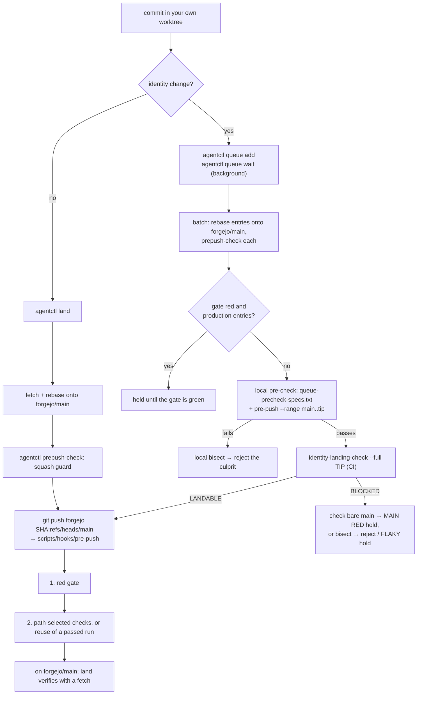

# Landing a change on main

How a commit gets from an agent's worktree onto `forgejo/main`, as the code stands on 2026-10-26 (main at
`fddbc8fcd`). The sources are authoritative; this page cites them and says nothing they do not:

- the pre-push hook, `scripts/hooks/pre-push` (its header lists every check);
- `~/bin/agentctl` (`land`, `queue`, `ci-why`, `prepush-check`) and its reference `~/bin/AGENTCTL.md` (laptop only,
  not in this repo);
- `scripts/identity-landing-check`, `scripts/identity-measure`;
- `scripts/queue-precheck-specs.txt`, the merge queue's local pre-check list.

There are no PRs and no other branches on the remote: the only ref that lands is `main` (the `measure/` branches the
identity tools push are run refs, never merged).

## The flow



## Stage 1: commit in your own worktree

```sh
git -C ~/projects/movies fetch forgejo
git -C ~/projects/movies worktree add -b <branch> ~/projects/movies-wt-<name> forgejo/main
eval "$(~/bin/agentctl env --print)"     # sbt/java on PATH; a locked vault prints the `! secrets unlock` line
```

Never the root checkout (`scripts/hooks/pre-commit` refuses a commit there; the pre-push hook warns on every push
when the root is off `main` or dirty, via `scripts/root-checkout-check`). Install the hooks once per clone with
`scripts/install-hooks.sh`: it sets `core.hooksPath=scripts/hooks`, relative, so each worktree runs its own copy. The
hook resets an absolute `core.hooksPath` that points at this clone, and a hook run for another checkout hands over to
that checkout's copy.

Before landing: `git diff --stat forgejo/main...HEAD` lists only your files, and the test layers your change touches
are green locally (CLAUDE.md, "Run the relevant test layers").

## Stage 2a: a non-identity change — `agentctl land`

```sh
~/bin/agentctl land          # from the worktree; under heavy-run when the hook will start sbt
```

`cmd_land` / `land_loop` in `~/bin/agentctl`, in order:

1. refuses when `PREPUSH_SKIP` is set in the environment, or the tree is dirty (`--stash` sets changes aside);
2. `git fetch forgejo main` (one retry after 15 s);
3. `git rebase forgejo/main` (a conflict aborts the rebase and names the files);
4. `prepush-check` (the squash guard): refuses when `forgejo/main...HEAD` returns more than 2 files to an older main
   version — what `git reset --soft` onto a moved main does (`git revert` commits are exempt for their own files);
5. `git push forgejo <sha>:refs/heads/main` (argv asserted free of `--no-verify` and `--force`), which runs the
   pre-push hook (stage 3) with sdkman's sbt/java first on PATH;
6. on a push race (`non-fast-forward`, `fetch first`, …) refetch, rebase and retry, up to 3 retries;
7. fetch and verify the commit is on main (ancestor, or patch-equivalent per `git cherry`).

The last line is `LANDED <sha>` or `NOT LANDED: <why>`; a red-gate refusal is followed by the `ci-why` summary. The
hook's full output is in the scratchpad's `agentctl-land-<worktree>-<pid>.log`.

## Stage 2b: an identity change — the merge queue

An identity change is one touching `identity/`, `worker/src/main/scala/services/identity/`,
`common/src/main/resources/title-{rules,words}.tsv`, `common/src/main/scala/services/titlerules/` or
`test/resources/fixtures/identity-*` (the hook's list); `queue add` also counts identity, matcher, resolver,
resolution or projection code outside `scripts/`, `docs/`, `.claude/` and the CI trees, and `--identity` forces it.
Iterate with `scripts/identity-measure --footprint`; when ready:

```sh
~/bin/agentctl queue add                    # committed work only; one open entry per worktree
~/bin/agentctl queue wait <entry>           # Bash run_in_background=true, then end your turn
~/bin/agentctl queue status                 # the batch, the processor's phase, every hold
```

Do not run `identity-landing-check --full` yourself and do not take a `/tmp/movies-landing-slot-*`: the queue does
both. The processor (`queue run`, started detached by `queue add`; one per repo, held by an flock; state in
`~/.cache/agentctl/queue/movies`) works one batch at a time:

1. **Batch.** Every queued entry, in order; entries added meanwhile go to the next batch.
2. **Gate.** When `ci-why` says main is red, production entries without `Fixes-Red:` are held; tools-only and
   `Fixes-Red:` entries go ahead (the hook's rule). The gate is read again right before any check is dispatched.
3. **Build.** Each entry is rebased (`git rebase --onto`) onto the tip so far and prepush-checked. A conflict or a
   refusal rejects that entry alone.
4. **Local pre-check** (no CI spent): the tip's `scripts/queue-precheck-specs.txt`, run in the queue's work tree —
   `sbt` lines through `scripts/sbt-warm`, `sh` lines in the shell, first failure stops. Today: the
   generated-artefacts drift, `Test/compile`, the IntegrationTest compiles of web and worker,
   `FilmScheduleEndToEndSpec` + `ReadModelSnapshotSpec`, and the worker's `DocCommentPlacementSpec`,
   `RegisteredCollectionListsSpec` and `deploy.*` specs minus those needing the GitOps manifests (budget ~5 min
   warm). Then the hook itself, `scripts/hooks/pre-push --range <main>..<tip>`. A red gate, a tunnel failure or stale
   manifests count as "could not judge", not as a failure. If the tip fails, bare main is pre-checked: fails too →
   hold `MAIN RED pre-check …`; otherwise the entries are bisected locally, the failing boundary re-run once, and only
   the culprit rejected (with the output and the diff of any file the check wrote, which is discarded). Unsure → the
   CI check decides. Results are cached per tree.
5. **Landing check.** One `scripts/identity-landing-check --full <tip>` for the whole batch (stage 4), in its own
   process group, holding a landing slot. Verdicts are cached by (main, tree).
6. **BLOCKED.** Blame needs proof. The same check on bare main (cached per main sha): any red there → hold
   `MAIN RED <signature> at <sha>`, nobody rejected. Green main → bisect to the first red prefix, re-check it once:
   same signature → reject that entry, push the green prefix, requeue the rest; green or a different signature →
   `FLAKY` hold, nobody rejected, nothing lands, logged to `flaky.log`. No verdict (exit 2) is never an entry's
   fault: hold `no-verdict`, retry with backoff, after 5 in a row wait for `queue resume`.
7. **Main moved during the check.** If every new main commit touches none of the paths the check covers (the
   identity landing paths and `.github/convergence-paths.txt` as of the new main), the batch is rebased and pushed
   under the verdict it has, given a clean rebase and a passing pre-check on the new tip. Anything else rebuilds and
   rechecks.
8. **Push** `git push forgejo <tip>:refs/heads/main` from the work tree, through the hook. A hook failure on a
   multi-entry batch is bisected locally with `pre-push --range`; only the culprit is rejected and the rest pushed
   under the verdict already taken (it covered a superset). A single entry's hook failure rejects it with the tail.

**No abandoned runs.** When a check returns, times out, or the processor is stopped, it kills the check's process
group, cancels every unfinished run on the `measure/` branches that check pushed, and deletes those branches. A
processor killed with SIGKILL leaves `active-check.json`; the next one cleans up from it. Other branches' runs are
never touched.

**Owner actions.** `queue hold [--reason R]` pauses persistently (a running check is stopped within 15 s, its runs
cancelled, the batch requeued); `queue resume` lifts a hold and refreshes the processor's Forgejo token;
`queue cancel <entry>` drops an entry, even one in the running batch (its check is stopped and the rest rebuilt);
`queue requeue <entry> [--last]` puts a wrongly rejected entry back.

`queue wait` exits 0 `LANDED <sha>`, 1 `REJECTED <why>`, 2 timeout (12 h), 3 `HELD <why>`.

## Stage 3: the pre-push hook

`scripts/hooks/pre-push`, run by git on every push (and by `--range` as a dry run). In order:

1. **Hand-over and hooksPath guard** (above), root-checkout warning.
2. **What is pushed.** git's stdin, one line per ref. Deleting a ref checks nothing. A push of only
   `refs/heads/measure/*` checks nothing (a measurement's run ref). For a push to `main`, `agentctl prepush-check
   --hook` (the squash guard) runs first, when `~/bin/agentctl` exists.
3. **The red gate** (push to main only; bypass name `redgate`). For each gating workflow — Main (`main.yml`),
   Identity model convergence (`identity-model-convergence.yml`), Verify scrape recording
   (`verify-scrape-recording.yml`) — it reads the newest *decided* run on main (success or failure; cancelled,
   skipped and unfinished runs say nothing), one bounded read each (`PREPUSH_GH_SECONDS`, 15 s). A Forgejo remote
   reads Forgejo's runs API with `$FORGEJO_API_TOKEN` or the `movies` vault's token if already unlocked; no token →
   the gate is skipped with one warning. An API that does not answer is warned about and skipped for that workflow,
   never a block. If any is red, every pushed commit touching a **production path** (`*/src/main/`, `conf/`,
   `*/conf/`, `build.sbt`, `project/`, `infra/nix/`, `infra/kubernetes/`, `Dockerfile`) must carry a
   `Fixes-Red: <run>` trailer naming one of the red runs — its number in the run URL or its API run id. Commits
   touching no production path (scripts, docs, skills, tests, fixtures, `.github/`) land while red. The Identity
   findings report and Record scrape fixtures (the nightly capture) do not gate.
4. **Changed paths**: a three-dot diff of each pushed range from its base, so commits main gained since do not count.
5. **Plan**: the checks those paths select (`scripts/hooks/pre-push --plan < paths` prints them).
6. **Reuse**: if a push with the same key passed before — pushed tree, base tree, changed paths, selected checks,
   the hook's and its helpers' bytes, the red-gate state and `PREPUSH_SKIP` — the path checks are skipped with one
   line (keys in `~/.cache/kinowo-prepush`, 14 days; single-ref pushes only; a failed run stores nothing;
   `PREPUSH_NO_REUSE=1` runs everything). The red gate always runs.
7. **Where**: in place when HEAD is the pushed commit and nothing it changed differs in the working tree; through the
   checkout's kept `scripts/sbt-warm` server if one is live; otherwise in a temporary worktree of the pushed commit
   (cold: an sbt check there takes minutes). A non-kept live sbt in the checkout also forces the temporary worktree.
8. **Identity advice.** For a change on the identity paths it prints: "identity change: did
   scripts/identity-landing-check say LANDABLE for <sha>?" — advice only; the hook never runs the landing check.
9. **The path checks**, in this order; a failure is recorded and the rest still run:

| Check | Runs when the push changes | What it runs | Typical time |
|---|---|---|---|
| `judgements` | `identity-judgements.tsv`, `identity-unmatched/*.tsv`, `expected-hard-clusters-*`, `scripts/ci/identity_{judgements,takes}*.py` | `scripts/ci/identity_judgements_lint.py`; for a judgements change also against the takes the newest convergence legs served | seconds (+ a cached artifact download) |
| `eslint` | `web/src/main/assets/js`, page-test JS, `eslint.config.js`, `eslint-rules/`, `package*.json`, Playwright specs | `npm run lint` (`npm ci` once per worktree) | seconds |
| `drift` | `*/src/main/scala/models/*`, `data/`, the City models, the drift script | `scripts/ci/generated-artefacts-drift.sh` | seconds |
| `snapshot` | `test/resources/fixtures/08-06-2026/`, its inputs script | `scripts/read-model-snapshot-inputs.sh check` | seconds |
| `dashboards` | `infra/nix/files/monitoring/`, `infra/test/test_dashboards.py` | `infra/test/test_dashboards.py` | < 1 s |
| `scripttests` | `scripts/`, `.github/scripts`, `.github/actions`, `android/scripts`, `ios/scripts`, `infra/bin`, `data/` | `scripts/run-script-tests --changed <base>`; beside it the same on Linux in Docker (`linux`); on a Mac again under `/bin/bash` 3.2 | seconds to minutes |
| `actionlint` | workflow files, composite actions | actionlint (+ shellcheck on `run:` blocks) | seconds |
| `shellcheck` | `*.sh`, `scripts/hooks/*` | shellcheck; fails only on warnings the push adds | seconds |
| `sbt` | Scala/Java, `build.sbt`, `project/`, Grafana dashboards, scripts/workflows under `scripts/`, `.github/`, `infra/`; and anything the lint specs read (`scripts/`, `.github/`, `.claude/`, `CLAUDE.md`, `build.sbt`, `project/`, `*/src/test/`, `*/src/it/`, page specs, worker fixtures, `testkit/`) | one sbt run: the Test/It/Page compiles of every touched module and its dependants (`--compile-plan`), the five standing lints, and on a repo-read change every `deploy/*Spec` and `tools/{No*,*Lint*}Spec` (`--lint-plan`) bar the server-booting ones; GitOps-reading specs only after `infra/bin/fetch-gitops` succeeds | well under a minute warm (lint plan ~30 s); minutes cold |
| `oldrefs` | a file in `identity-slice`'s or `title-trace`'s `TOOL_FILES` | `scripts/identity-slice-old-ref-test.sh` | incremental; minutes the first time |
| `ios` | `ios/` | `scripts/ios-compile-check.sh` | minutes |

10. **Verdict.** `all clear (<n>s)` and the pass stored for reuse, or
    `blocked by: <checks> … Fix, or bypass with PREPUSH_SKIP=…`. A hook that ran over `PREPUSH_LONG_SECONDS` (300)
    warns that the push's ssh connection, opened before the hook, may die ("closed by remote host", "Broken pipe"):
    push the same thing again and the stored pass is reused.

A local tool a check needs that is missing (sbt or a working java, shellcheck, actionlint, npm, python3 and
timezonefinder, gh, curl, jq) **blocks** the push with the fix, never a skip. Only what lies outside the machine's
install warns and passes: the gate's API unreachable, no Forgejo token, Docker or Xcode not running. GitOps manifests
that cannot be fetched block (the checkout left behind is stale).

**Check-only mode.** `scripts/hooks/pre-push --range A..B` runs the whole hook — gate and checks — over the commits in
`A..B`, judged as a push to main, pushing nothing. A `<remote>/main..HEAD` base reads that remote's runs, so the push
that follows reuses the pass. Use it before a manual push that may run long: `scripts/hooks/pre-push --range
forgejo/main..HEAD`. `--plan` and `--compile-plan` read paths on stdin and print the plan only.

## Stage 4: `scripts/identity-landing-check`

"Will this identity change land green?" — one verdict over the measure and the identity specs Main runs. The queue
runs it as `--full <tip>`; by hand it is for iterating only (default mode: `identity-measure --footprint`).

- **Spec groups**, by default each its own `scripts/identity-ci-run` (identity-run.yml) on CI at the commit, all at
  once, on the check tier (`ubuntu-24.04`); `--local` runs them on the laptop through `scripts/sbt-warm`:
  - `unit`: `testOnly services.identity.* services.titlerules.* scripts.* tools.DocCommentPlacementSpec
    tools.HardClusterRatchetSpec` (root testOnly: every module);
  - `it`: `worker/IntegrationTest/testOnly integration.HardClusterConvergenceIntegrationSpec`;
  - `e2e-corpus` (`FilmScheduleEndToEndSpec`) and `e2e-rest` (`SearchQueryMarkersSpec`,
    `IdentityCutoverEndToEndSpec`), only when `scripts/ci/ci-row-scope.sh e2e` says Main would run the e2e rows.
  The sbt log decides a group, not the run's conclusion.
- **The measure**, in parallel: `scripts/identity-measure --head <commit> --base <base> --tier landing` plus
  `--footprint` (default), `--footprint-only`, or `--full`. `--full` currently runs the whole convergence suite
  (identity-measure: "run the whole convergence suite, not only the takes rows"; ~22 rows on ci-runner's 3-slot
  `landing` runner), so Main's convergence run on the same tree can reuse the verdict
  (`scripts/ci/convergence_reuse.py`). A change to make the landing measure takes-only is in progress and **had not
  landed** at `fddbc8fcd`; re-read `scripts/identity-landing-check` and `scripts/identity-measure` when it does.
- **Verdict**, last on stdout: `LANDABLE` (exit 0); `BLOCKED` (exit 1) with each failing spec, its test and a hint;
  `NO VERDICT` (exit 2) when a group or the measure could not run. Output under
  `target/identity-landing-check/<sha>/` (the queue sets `IDENTITY_LANDING_OUT`).

## Stage 5: the gate after landing

`~/bin/agentctl ci-why [main|<run id>]` explains why main is red: the newest decided run on main of each gating
workflow, its failed jobs and lines, the commit, and a verdict (`TEST FAILURE`, `INFRA-SHAPED`, `UNCLEAR`), a newer
run in flight that may clear it, and the clearing rule. Exit 0 green, 1 red.

A red clears only when that workflow's next **decided** run on main is green (a cancelled run says nothing), or —
for the push itself — when every production commit in it carries `Fixes-Red:` naming the red run. If your commit
turned main red, fix it at once with a `Fixes-Red: <run>` trailer in the final trailer block, beside
`Co-Authored-By`.

## When something blocks you

| Message | Meaning | What to do |
|---|---|---|
| `NOT LANDED: PREPUSH_SKIP is set …` | land never skips checks | `unset PREPUSH_SKIP` |
| `NOT LANDED: the working tree has uncommitted changes` | dirty tree | commit, or `land --stash` |
| `NOT LANDED: rebase onto forgejo/main conflicts in: …` | your change conflicts with main | resolve by hand (`git rebase forgejo/main`), land again |
| `NOT LANDED: prepush-check refused: … would be reverted/deleted back to an older main version` | a squash onto a moved main | rebuild your commits on current main by rebase, never `reset --soft` |
| `<workflow> is RED on main: run …` / `NOT LANDED: the red gate refused the push` | a gating run is red and a production commit lacks `Fixes-Red:` | `agentctl ci-why`; wait (`agentctl wait run <id>` in the background) for the green run, or add `Fixes-Red:` only if your commit fixes that run |
| `no Forgejo token … red-build gate SKIPPED` | warning only | for a real gate: `secrets unlock movies` (the user's Touch ID) |
| `<tool> not found: the <check> check cannot run, so the push is BLOCKED` | a local tool is missing | install it as the message says; `eval "$(~/bin/agentctl env --print)"` for sbt/java |
| `GitOps manifests STALE … BLOCKED` | `infra/bin/fetch-gitops` could not reach movies-gitops | `launchctl kickstart -k gui/$(id -u)/net.bitcashier.forgejo-tunnel`, land again |
| `blocked by: <checks>` | a path check failed | read the tail (and the land log), fix forward, commit, land again |
| push dies after `all clear` ("closed by remote host", "Broken pipe") | the tunnel dropped under a long hook | push/land again: the pass is reused |
| `NOT LANDED: still racing after 3 retries` | main is busy | land again in a minute |
| `REJECTED <why>` (queue) | your entry conflicts, failed the pre-check, the hook, or the landing check (bisected) | yours: fix forward, commit, `queue add` again |
| `HELD flaky <spec>` (queue, exit 3) | a red that did not reproduce; nothing landed | not yours unless your change touches that spec: report it and stop. Never rerun, never `queue resume` — the owner's call |
| `MAIN RED …` hold | main itself fails the check or pre-check | keep `queue wait` running: it resumes once main moves and the gate is green |
| `held: main went red for the gate` | production entry, gate red | as above; resumes by itself |
| `HELD no-token: run secrets unlock movies, then agentctl queue resume` | the processor has no Forgejo token | the user unlocks; then `queue resume` |
| `HELD no-verdict … (n/5)` | infra or dispatch trouble | retries by itself; after 5, the owner resumes |
| `PAUSED by the owner: <reason>` | `queue hold` | wait; the owner resumes |
| hook says `identity change: did scripts/identity-landing-check say LANDABLE …` | advice | an identity change goes through the queue, not `land` |

## The rules

- **No bypass flags.** `PREPUSH_SKIP="<checks>"` (names: every check above, plus `redgate`, `lintspecs`, `linux`)
  and `git push --no-verify` exist in the hook for a person; agents never use them, on any commit or push, `measure/`
  branches included. `agentctl land` and the queue processor refuse to run with `PREPUSH_SKIP` set and assert no
  `--no-verify` in their push argv. A missing tool is fixed, not skipped.
- **`Fixes-Red:` only for a real fix** of the named run. A tools-only commit needs none.
- **Never rerun to green.** A red is investigated to its cause (CLAUDE.md, "Investigate every red"); a test that
  passes on a second run is flaky and gets fixed. The queue never picks a winner between a red and a green run: it
  holds `FLAKY`.
- **Rebase onto current `forgejo/main` before any landing check**; never `reset --soft` onto a moved main.
- **Never edit `identity-drift-allow.tsv` to get green**; performance budgets move only for a deliberate trade.
- Cancel your own superseded CI runs (`forgejo-gh run cancel <run id>`); never another agent's.
